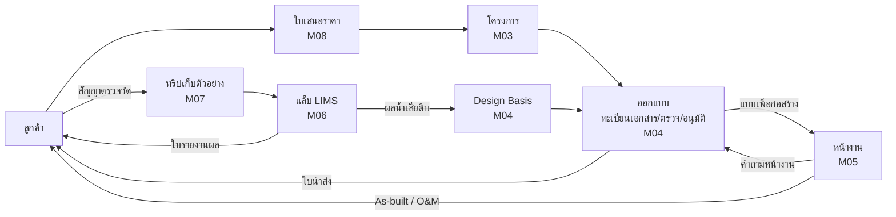

# 00 · ภาพรวมระบบ WEMS

> **WEMS** (Water Engineering Management System) เป็นชื่อรหัสชั่วคราว เปลี่ยนเป็นชื่อบริษัท/ผลิตภัณฑ์จริงได้ภายหลัง (ค้นหา-แทนที่ `wems` / `WEMS`)

## 1. บริบทธุรกิจ

บริษัทให้บริการด้านน้ำ 3 สายงาน ซึ่งส่งต่องานถึงกัน:

| สายงาน | งานหลัก | ผลงานที่ส่งลูกค้า |
|---|---|---|
| **ออกแบบ (Design)** | ออกแบบระบบผลิตน้ำประปา ระบบบำบัดน้ำเสีย ระบบท่อ/สูบน้ำ | รายการคำนวณ แบบ ข้อกำหนด BOQ รายงานการออกแบบ |
| **บริหารโครงการ (PM)** | ก่อสร้าง/ติดตั้ง/ทดสอบเดินระบบ ควบคุมงานหน้างาน | ความคืบหน้า รายงานประจำวัน แบบก่อสร้างจริง (As-built) คู่มือ O&M |
| **วิเคราะห์น้ำ (Lab)** | เก็บตัวอย่าง วิเคราะห์คุณภาพน้ำ เปรียบเทียบกับมาตรฐาน | ใบรายงานผลการวิเคราะห์ |

ปัญหาที่ระบบต้องแก้ (สมมติฐาน ให้ยืนยันใน `open-questions.md`):
- ทะเบียนแบบอยู่ใน Excel หลายไฟล์ เลขเอกสาร/Revision ซ้ำหรือสับสน
- ส่งแบบให้ลูกค้าทางอีเมล/LINE โดยไม่มีหลักฐานว่าส่งฉบับไหน เมื่อไร
- หน้างานใช้แบบฉบับเก่า ทำให้ต้องรื้อแก้
- การตรวจ/อนุมัติแบบไม่มีร่องรอย ไม่รู้ว่าค้างที่ใคร
- ผลแล็บกรอกซ้ำหลายที่ ตรวจสอบย้อนกลับยาก

## 2. เป้าหมาย

| รหัส | เป้าหมาย | เฟส |
|---|---|---|
| G1 | ทะเบียนแบบและเอกสารแหล่งเดียว ออกเลขและ Revision อัตโนมัติ | 1 |
| G2 | ตรวจ/อนุมัติเป็นขั้นตอน มีร่องรอยครบ ลงนามอิเล็กทรอนิกส์ได้ | 1 |
| G3 | ส่งเอกสารให้ลูกค้าผ่านใบนำส่ง (Transmittal) ตรวจสอบย้อนหลังได้ | 1 |
| G4 | ทีมหน้างานเปิดแบบฉบับล่าสุดบนมือถือได้แม้ออฟไลน์ | 1 (ดูแบบ) / 2 (รายงานหน้างาน) |
| G5 | บริหารโครงการ: แผนงาน งวดงาน รายงานประจำวัน ปัญหาหน้างาน | 2 |
| G6 | LIMS: ตัวอย่าง → ผล → รายงาน ตรวจสอบย้อนกลับได้ตามแนว ISO/IEC 17025 | 3 |
| G7 | ใบเสนอราคา สถานะวางบิล Timesheet และ Dashboard ผู้บริหาร | 4 |

**ไม่อยู่ในขอบเขต (Non-goals)**
- ไม่ใช่ระบบบัญชี/ภาษี/e-Tax Invoice: ใช้ระบบบัญชีเดิม และส่งออกข้อมูลไปแทน
- ไม่ใช่โปรแกรม CAD/BIM: ระบบเก็บไฟล์ต้นฉบับ (DWG/RVT/XLSX) และใช้ PDF สำหรับดูและตรวจ
- **ไม่มีพอร์ทัลลูกค้าหรือผู้รับเหมา**: ผู้ใช้ระบบคือพนักงานเท่านั้น ลูกค้ารับเอกสารทางอีเมลหรือลิงก์ดาวน์โหลดที่มีวันหมดอายุ
- ไม่ทำ HR/เงินเดือน

## 3. ผู้ใช้ (พนักงานภายในเท่านั้น)

| บทบาท | งานหลักในระบบ | อุปกรณ์หลัก |
|---|---|---|
| ผู้บริหาร | ดูภาพรวม อนุมัติใบเสนอราคา | เว็บ + มือถือ |
| ผู้จัดการโครงการ (PM) | สร้างโครงการ จัดทีม ติดตามเอกสาร อนุมัติ | เว็บ + มือถือ |
| วิศวกรออกแบบ / ช่างเขียนแบบ | ลงทะเบียนเอกสาร อัปโหลด ส่งตรวจ แก้ตามความเห็น | เว็บ |
| ผู้ตรวจ / ผู้อนุมัติแบบ | ตรวจ ให้ความเห็น อนุมัติ (ผู้อนุมัติบางประเภทต้องมีใบอนุญาต กว.) | เว็บ + มือถือ |
| เจ้าหน้าที่ควบคุมเอกสาร (DC) | ดูแลทะเบียน ออกใบนำส่ง บันทึกผลตอบกลับของลูกค้า | เว็บ |
| วิศวกรสนาม / โฟร์แมน | ดูแบบล่าสุด รายงานประจำวัน แจ้งปัญหา (เฟส 2) | **มือถือ** |
| ผู้จัดการห้องปฏิบัติการ / ผู้มีอำนาจลงนาม | ทบทวนผล อนุมัติ ออกรายงาน (เฟส 3) | เว็บ |
| นักวิเคราะห์ | รับตัวอย่าง บันทึกผล QC (เฟส 3) | เว็บ (แท็บเล็ตในแล็บ) |
| เจ้าหน้าที่เก็บตัวอย่าง | ทริปเก็บตัวอย่าง วัดค่าภาคสนาม (เฟส 3) | **มือถือ** |
| ธุรการ / ขาย / บัญชี | ลูกค้า ใบเสนอราคา สถานะวางบิล (เฟส 4) | เว็บ |
| ผู้ดูแลระบบ | ผู้ใช้ สิทธิ์ ค่าตั้งต้น | เว็บ |

## 4. โมดูลและเฟส

| โมดูล | สเปก | เฟส |
|---|---|---|
| M01 Platform (ผู้ใช้ สิทธิ์ ไฟล์ เลขเอกสาร แจ้งเตือน Audit) | `modules/M01-platform.md` | 0 |
| M02 ลูกค้าและสถานที่ | `modules/M02-clients-sites.md` | 1 (พื้นฐาน) / 3 (จุดเก็บตัวอย่าง) |
| M03 โครงการ | `modules/M03-projects.md` | 1 (ทะเบียน+ทีม) / 2 (แผนงาน งวดงาน) |
| **M04 งานออกแบบและเอกสาร ★ MVP** | `modules/M04-design-documents.md` | **1** |
| M05 บริหารหน้างาน | `modules/M05-site-management.md` | 2 |
| M06 ห้องปฏิบัติการ (LIMS) | `modules/M06-lab-lims.md` | 3 |
| M07 เก็บตัวอย่างภาคสนาม | `modules/M07-sampling.md` | 3 |
| M08 งานขายและการเงิน | `modules/M08-commercial.md` | 4 |
| M09 รายงานและ Dashboard | `modules/M09-reports-dashboards.md` | 4 |
| การเชื่อมต่อภายนอก (SSO, LINE OA, ส่งออกบัญชี) | `10-roadmap.md` เฟส 5 | 5 |

## 5. การไหลของงานระหว่างสายงาน

จุดเชื่อมที่ต้องออกแบบไว้ตั้งแต่ต้น แม้บางโมดูลจะมาทีหลัง:
- **ลูกค้า/สถานที่ (M02)** ใช้ร่วมกันทุกสายงาน
- **Parameter และมาตรฐานน้ำทิ้ง** ใช้ร่วมกันระหว่าง Design Basis (M04) กับแล็บ (M06)
- **เอกสารแบบ (M04)** ถูกอ้างถึงจากปัญหาหน้างานและคำถามหน้างาน (M05)

## 6. นิยาม MVP (เฟส 1)

ผู้ใช้ทำงานครบวงจรนี้ได้บนระบบจริง:

1. สร้างลูกค้า สถานที่ และโครงการ พร้อมกำหนดทีม
2. ลงทะเบียนเอกสาร (หรือนำเข้าจาก Excel) ได้เลขอัตโนมัติ
3. อัปโหลดไฟล์ ส่งตรวจตาม workflow → ผู้ตรวจให้ความเห็นบน PDF → อนุมัติด้วยการยืนยันตัวตนซ้ำ
4. ออกใบนำส่งเป็น PDF ส่งอีเมลให้ลูกค้า บันทึกการรับและรหัสตอบกลับ
5. บนมือถือ: ดูทะเบียนและเปิด PDF ฉบับล่าสุดแบบออฟไลน์ อนุมัติงานที่ค้าง รับ push notification

**ตัวชี้วัดความสำเร็จ (ทบทวนหลังใช้งาน 3 เดือน)**
- เอกสารของโครงการใหม่ลงทะเบียนในระบบ 100%
- เอกสารที่ส่งลูกค้าทั้งหมดส่งผ่านใบนำส่ง
- ระยะเวลาตรวจ/อนุมัติเฉลี่ยวัดได้ และลดลงจากเดือนแรก
- ไม่มีกรณีหน้างานใช้แบบผิด Revision

## 7. ข้อสมมติฐาน (ยืนยันใน `open-questions.md`)

- ผู้ใช้ประมาณ 50–150 คน ใช้งานพร้อมกันไม่เกิน 100 คน
- ภาษาไทยเป็นหลัก มีภาษาอังกฤษรอง
- อินเทอร์เน็ตหน้างานไม่เสถียร มือถือต้องทำงานออฟไลน์ได้
- บริษัทมีอีเมลองค์กร (Microsoft 365 หรือ Google Workspace)
- ทีมดูแลระบบหลังส่งมอบเป็นนักพัฒนา TypeScript/Flutter หรือใช้ Claude Code ต่อ

## 8. แผนที่เอกสารสเปก

| ไฟล์ | อ่านเมื่อ |
|---|---|
| `01-glossary.md` | ศัพท์เฉพาะ รหัสสาขา/ประเภทเอกสาร/วัตถุประสงค์การส่ง |
| `02-architecture.md` | โครงสร้าง repo, tech stack, การ deploy |
| `03-data-model.md` + `apps/api/prisma/schema/` | ก่อนแตะฐานข้อมูล |
| `04-api-conventions.md` | ก่อนสร้าง/แก้ endpoint |
| `05-workflows.md` | ก่อนเขียน logic เปลี่ยนสถานะ |
| `06-security.md` | สิทธิ์ การยืนยันตัวตน PDPA |
| `07-web-ui.md` / `08-mobile.md` | ก่อนทำหน้าจอเว็บ / แอป |
| `09-nfr.md` | ประสิทธิภาพ สำรองข้อมูล การติดตามระบบ |
| `10-roadmap.md` | **ลำดับงานและเกณฑ์รับงาน** |
| `11-testing.md` | กลยุทธ์ทดสอบและข้อมูลตัวอย่าง |
| `modules/*.md` | กติกาธุรกิจ หน้าจอ API ของแต่ละโมดูล |
| `adr/*.md` | เหตุผลของการตัดสินใจสำคัญ |
| `open-questions.md` | เรื่องที่บริษัทต้องยืนยัน |
