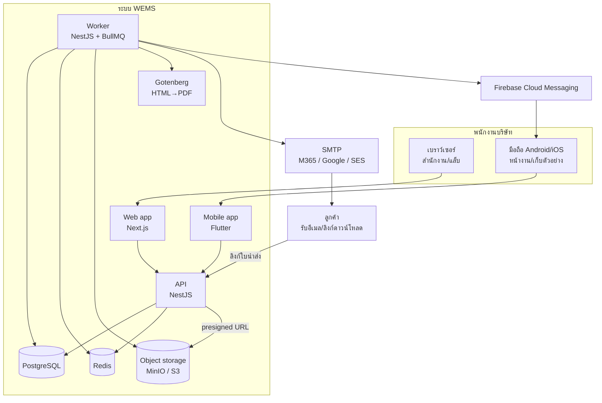
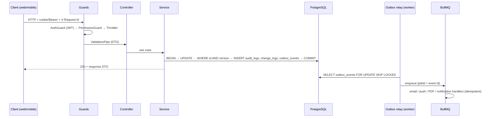
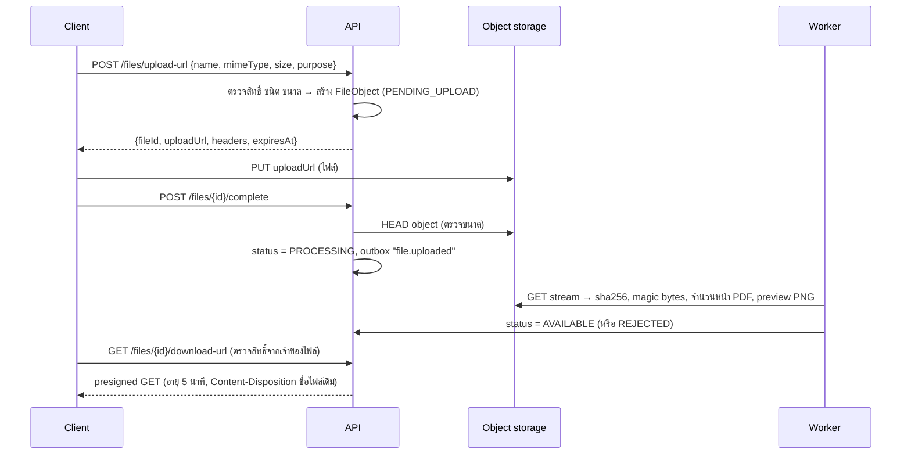
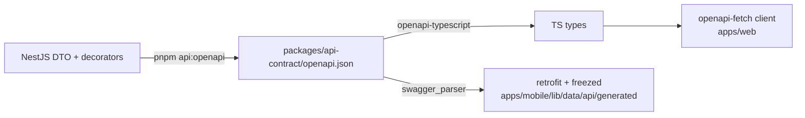

# 02 · สถาปัตยกรรมระบบ

## 1. ภาพรวม (System context)



หลักการ:
- **API เดียว** ให้บริการทั้งเว็บและมือถือ ทุกกติกาธุรกิจอยู่ที่ API — web/mobile ห้ามตัดสินสิทธิ์หรือสถานะเอง
- **Worker แยก process** สำหรับงานช้า/งานเบื้องหลัง: สร้าง PDF, ส่งอีเมล/push, ประมวลผลไฟล์, แจ้งเตือนตามเวลา
- **ไฟล์ไม่ผ่าน API**: client อัปโหลด/ดาวน์โหลดตรงกับ object storage ด้วย presigned URL
- ผู้ใช้เป็นพนักงานเท่านั้น; ภายนอกเข้าถึงได้ทางเดียวคือ **ลิงก์ดาวน์โหลดของใบนำส่ง** ที่มีวันหมดอายุ

## 2. Tech stack

ใช้เวอร์ชัน stable ล่าสุด ณ วันที่ scaffold และล็อกด้วย lockfile (`pnpm-lock.yaml`, `pubspec.lock`) — ห้ามใช้ RC/beta ใน production

| ชั้น | เทคโนโลยี | หมายเหตุ |
|---|---|---|
| Monorepo | pnpm workspaces + Turborepo | Flutter อยู่ใน `apps/mobile` แต่ใช้เครื่องมือ Flutter ของตัวเอง |
| API | NestJS + TypeScript (strict) | `class-validator` + `class-transformer` สำหรับ DTO, `@nestjs/swagger` (เปิด CLI plugin) |
| ORM | **Prisma 7.x** | ณ วันที่เขียน stable ล่าสุดคือ 7.10.0 และ npm tag `latest` ชี้ไป 8.0.0-rc — ให้ติดตั้ง `prisma@7` จนกว่า 8.x จะออก GA; generator `prisma-client` + `moduleFormat = "cjs"` (Nest เป็น CommonJS), PrismaClient ต้องส่ง `adapter: new PrismaPg(...)`, URL และคำสั่ง seed อยู่ใน `apps/api/prisma.config.ts`, Prisma 7 ไม่โหลด `.env` เอง (ใช้ `dotenv/config`) — ต้องการ Node ≥ 20.19 (แนะนำ 22) และ TypeScript ≥ 5.4 |
| ฐานข้อมูล | PostgreSQL 16 ขึ้นไป | extension `pg_trgm` (ค้นหา) |
| Queue/Cache | Redis 7 + BullMQ | queue, rate limit, SSE fan-out (pub/sub) |
| Object storage | S3-compatible (MinIO on-prem / AWS S3 / R2) | bucket versioning เปิด |
| PDF | Gotenberg (Chromium) + HTML template | **ตัดคำภาษาไทยถูกต้อง** (ICU) — ดู ADR-0003 |
| จัดการ PDF | `pdf-lib` | ประทับตรา/ลายน้ำบน PDF แบบ; หน้าปก/ใบนำส่งใช้ Gotenberg |
| Preview | `pdftoppm` (poppler-utils) ใน worker image | ทำรูปหน้าแรก PNG |
| Web | Next.js (App Router) + TypeScript + Tailwind CSS + shadcn/ui | Next.js 16 ขึ้นไปใช้ไฟล์ `proxy.ts` แทน `middleware.ts` |
| Web data | TanStack Query + TanStack Table + react-hook-form + zod | client ต่อ API ด้วย `openapi-fetch` |
| Web i18n | next-intl (th ค่าเริ่มต้น, en) | ป้าย enum จาก `docs/data/enum-labels.json` |
| PDF viewer (web) | `pdfjs-dist` (หรือ `react-pdf`) + layer หมุดความเห็นของเราเอง | |
| Mobile | Flutter (stable) + Dart 3 | Material แยกเป็นแพ็กเกจ `material_ui` แล้ว — ใช้ตามที่ `flutter create` เวอร์ชันนั้นสร้าง และห้าม import ปนสองแบบ |
| Mobile state/routing | Riverpod (+ riverpod_generator), go_router | |
| Mobile data | dio + retrofit (สร้างด้วย `swagger_parser`), freezed + json_serializable, drift (SQLite) | ดู `08-mobile.md` |
| Mobile อื่นๆ | pdfrx (ดู PDF, MIT), flutter_secure_storage, firebase_messaging, mobile_scanner, geolocator, image_picker, workmanager | |
| Auth | JWT access token (15 นาที) + refresh token หมุนเวียน, argon2id, TOTP (ทางเลือก), OIDC SSO (เฟส 5) | ดู `06-security.md` |
| อีเมล | Nodemailer ผ่าน SMTP | template ไทย/อังกฤษ |
| Push | Firebase Cloud Messaging (firebase-admin) | |
| Observability | pino (JSON log) + request id, Sentry (API/web/mobile), `/health/live`, `/health/ready` | OpenTelemetry เป็นทางเลือก |
| Test | Jest/Vitest + Supertest + Testcontainers (API), Vitest + Testing Library + Playwright (web), flutter_test + integration_test (mobile) | ดู `11-testing.md` |
| CI | GitHub Actions | ดู §9 |

## 3. โครงสร้าง repository

```text
wems/
├── CLAUDE.md                     # กติกาสำหรับ Claude Code
├── README.md
├── docs/                         # สเปก (แหล่งความจริงของ requirement)
├── .claude/                      # rules ตาม path + skills
├── apps/
│   ├── api/                      # NestJS: HTTP API + worker (2 entrypoints)
│   │   ├── prisma/
│   │   │   ├── schema/*.prisma   # แหล่งความจริงของฐานข้อมูล
│   │   │   ├── migrations/
│   │   │   └── seed/             # seed.ts + อ่าน docs/data/seed/*.csv
│   │   ├── prisma.config.ts
│   │   ├── src/
│   │   │   ├── main.ts           # HTTP server
│   │   │   ├── worker.ts         # BullMQ workers + outbox relay + scheduler
│   │   │   ├── generated/prisma/ # Prisma client (ห้ามแก้มือ, gitignore)
│   │   │   ├── common/           # auth, errors, pagination, prisma, audit, change-log, outbox, numbering, files, notifications, pdf, mail, signature
│   │   │   └── modules/          # platform, clients, projects, documents, transmittals, design-basis, site, lab, sampling, commercial, reports, sync
│   │   ├── templates/            # HTML template ของ PDF และอีเมล (+ ฟอนต์ Sarabun)
│   │   └── test/                 # e2e/integration
│   ├── web/                      # Next.js
│   └── mobile/                   # Flutter
├── packages/
│   ├── api-contract/             # openapi.json + TS types ที่ generate (ห้ามแก้มือ)
│   └── config/                   # eslint, tsconfig, prettier ที่ใช้ร่วม
├── tools/                        # สคริปต์ตรวจสเปก เช่น check-enum-labels.mjs
├── infra/
│   ├── docker-compose.yml        # dev: postgres, redis, minio, mailpit, gotenberg
│   ├── docker-compose.prod.yml
│   └── caddy/Caddyfile
└── .github/workflows/
```

## 4. โครงสร้างโมดูลฝั่ง API

```text
src/modules/documents/
├── documents.module.ts
├── documents.controller.ts        # HTTP เท่านั้น: รับ DTO เรียก service คืน response DTO
├── documents.service.ts           # use case + transaction + audit + change log + outbox
├── revisions.service.ts
├── review.service.ts
├── domain/                        # pure functions ไม่มี I/O — ทดสอบง่าย
│   ├── revision-label.ts          # คำนวณ revision ถัดไป (BR-DOC-020..024)
│   ├── review-state-machine.ts    # transition ที่อนุญาต (05-workflows.md)
│   └── approver-eligibility.ts    # ตรวจใบอนุญาต/แยกหน้าที่ (BR-DOC-040..042)
├── dto/                           # *.request.dto.ts, *.response.dto.ts
├── policies/                      # ตรวจสิทธิ์ระดับ resource
└── events.ts                      # ชื่อ outbox event ของโมดูล
```

กติกาชั้น:
1. Controller ห้ามเรียก Prisma ตรง และห้ามมี business logic
2. Service ทำงานใน `prisma.$transaction` เดียว: เปลี่ยนข้อมูล → `AuditService.record()` → `ChangeLogService.touch()` → `OutboxService.publish()` แล้ว commit พร้อมกัน
3. กติกาสถานะอยู่ใน `domain/*` เป็น pure function ที่มี unit test ครบทุก transition
4. โมดูลเรียกกันผ่าน service ที่ export เท่านั้น ห้าม import repository/Prisma ของโมดูลอื่นเพื่อเขียนข้อมูลข้ามโมดูล

## 5. เส้นทางของ request



## 6. งานเบื้องหลัง (Worker)

- **Outbox relay**: อ่าน `outbox_events` ที่ยังไม่ประมวลผล ทุก 1 วินาที (`FOR UPDATE SKIP LOCKED`, ครั้งละ 100) ส่งเข้า BullMQ ด้วย `jobId = event.id` แล้วตั้ง `processedAt` — ถ้าล้มเหลวเพิ่ม `attempts` และเลื่อน `availableAt` แบบ exponential backoff
- **Queues**: `notifications` (สร้าง Notification + ส่ง email/push), `pdf` (ใบนำส่ง CRS รายงาน), `files` (sha256, preview, จำนวนหน้า, ตรวจชนิดไฟล์), `mail`, `scheduled`
- **งานตามเวลา** (BullMQ repeatable jobs, เวลา Asia/Bangkok):

| งาน | เวลา | ทำอะไร |
|---|---|---|
| review-reminders | ทุกวัน 08:30 | เตือนขั้นตรวจที่ครบกำหนดพรุ่งนี้/เลยกำหนด (BR-DOC-038) |
| license-expiry | ทุกวัน 08:00 | เตือนใบอนุญาตที่จะหมดอายุใน 60/30/7 วัน |
| transmittal-link-expiry | ทุกชั่วโมง | ปิดลิงก์ที่หมดอายุ |
| cleanup | ทุกวัน 02:00 | ลบ idempotency record หมดอายุ, ไฟล์ PENDING_UPLOAD เกิน 24 ชม., change log เกิน 90 วัน |
| (เฟส 3) holding-time | ทุก 30 นาที | เตือนตัวอย่างใกล้หมดระยะเวลาเก็บรักษา |
| (เฟส 3) calibration-due | ทุกวัน 08:00 | เตือนเครื่องมือใกล้ครบกำหนดสอบเทียบ |

Handler ทุกตัวต้อง **idempotent** (รันซ้ำได้ผลเหมือนเดิม) เพราะ BullMQ อาจ retry

## 7. ไฟล์



- key ใน storage: `{env}/{yyyy}/{mm}/{fileId}/{sanitizedName}` — ห้ามใช้ชื่อไฟล์ผู้ใช้เป็น key ตรงๆ
- ขนาดสูงสุด 1 GB ต่อไฟล์ (single PUT); ไฟล์ใหญ่กว่านี้ใช้ multipart upload ในเฟส 5 ถ้าจำเป็น
- ชนิดที่อนุญาตและรายละเอียดอื่นดู `modules/M01-platform.md` §5

## 8. PDF

- ทุกเอกสารที่ระบบสร้าง (ใบนำส่ง, CRS, ทะเบียนเอกสาร, ใบรายงานผล, ใบเสนอราคา) = HTML template + CSS → **Gotenberg (Chromium)** → PDF เพราะ Chromium ตัดคำภาษาไทยถูกต้อง ส่วนไลบรารีสร้าง PDF ใน Node ส่วนใหญ่ตัดคำไทยไม่ได้
- ฟอนต์: **Sarabun** (Google Fonts, SIL OFL) ฝังใน template (`templates/fonts/`) ห้ามพึ่งฟอนต์ในเครื่อง
- หัว/ท้ายกระดาษและเลขหน้าใช้ header/footer ของ Gotenberg
- ตราประทับบน PDF แบบ ("SUPERSEDED", "PRELIMINARY – NOT FOR CONSTRUCTION", "APPROVED Rev.B 26/09/2569") ทำด้วย `pdf-lib` ตอนดาวน์โหลด (ไม่แก้ไฟล์ต้นฉบับ) — ข้อความภาษาไทยในตราให้ render เป็น PDF เล็กด้วย Gotenberg แล้ว `embedPage` ซ้อน เพราะ `pdf-lib` จัดวางสระ/วรรณยุกต์ไทยไม่ถูก

## 9. Environments และการ deploy

| Env | ที่อยู่ | หมายเหตุ |
|---|---|---|
| local | `docker compose -f infra/docker-compose.yml up` | postgres, redis, minio, mailpit (ดูอีเมล), gotenberg |
| staging | เซิร์ฟเวอร์/VM แยก | ข้อมูลทดสอบ, ใช้สำหรับ UAT |
| production | on-prem หรือ cloud (ยืนยันใน open-questions) | Docker Compose + Caddy (TLS อัตโนมัติ) |

การจัดเส้นทาง (โดเมนเดียว เพื่อให้ cookie เป็น same-origin):
```text
https://wems.<company>.co.th/          → web (Next.js)
https://wems.<company>.co.th/api/      → api (NestJS, global prefix "api")
https://wems.<company>.co.th/t/<token> → หน้าดาวน์โหลดใบนำส่งสาธารณะ (Next.js route ที่เรียก API)
```

CI (GitHub Actions) ต่อ pull request:
1. `pnpm install --frozen-lockfile` → lint → typecheck → unit test
2. API: `prisma validate`, ตรวจว่า migration ตรงกับ schema (`prisma migrate diff --exit-code`), integration test กับ PostgreSQL service container
3. OpenAPI: generate `packages/api-contract/openapi.json` แล้ว `git diff --exit-code` (ต้อง commit ของที่ generate)
4. Web: build + Playwright smoke test
5. Mobile: `flutter analyze`, `flutter test`, build APK (debug)
6. `node tools/check-enum-labels.mjs` (ป้าย enum ครบทุกค่า)

## 10. สัญญา API (OpenAPI เป็นแหล่งความจริง)



- เปลี่ยน API = แก้ DTO/controller → generate → commit ผลลัพธ์ทั้งสามที่ใน PR เดียวกัน
- ห้ามเขียน type ของ API ซ้ำด้วยมือใน web/mobile

## 11. ค่าตั้ง (environment variables) หลัก

| ตัวแปร | ใช้ที่ | ตัวอย่าง/หมายเหตุ |
|---|---|---|
| `DATABASE_URL` | api, worker | `postgresql://wems:***@db:5432/wems` |
| `REDIS_URL` | api, worker | `redis://redis:6379` |
| `S3_ENDPOINT`, `S3_REGION`, `S3_BUCKET`, `S3_ACCESS_KEY`, `S3_SECRET_KEY`, `S3_FORCE_PATH_STYLE` | api, worker | MinIO ใช้ path style |
| `JWT_ACCESS_SECRET`, `JWT_ACCESS_TTL=900` | api | secret ยาว ≥ 32 ไบต์ |
| `REFRESH_TTL_WEB_DAYS=7`, `REFRESH_TTL_MOBILE_DAYS=30` | api | idle timeout ของเว็บอยู่ใน setting `security.sessionIdleMinutes` |
| `APP_ENCRYPTION_KEY` | api | AES-256-GCM สำหรับ TOTP secret (base64 32 ไบต์) |
| `PUBLIC_BASE_URL` | api, worker | สร้างลิงก์ในอีเมล |
| `SMTP_HOST`, `SMTP_PORT`, `SMTP_USER`, `SMTP_PASS`, `MAIL_FROM` | worker | |
| `GOTENBERG_URL` | worker | `http://gotenberg:3000` |
| `FCM_CREDENTIALS_JSON` | worker | service account (secret) |
| `SENTRY_DSN` | ทุก app | |
| `TZ_BUSINESS=Asia/Bangkok` | api, worker | ใช้คำนวณวันครบกำหนด/งานตามเวลา |

## 12. การตัดสินใจสำคัญ (ADR)

| ADR | เรื่อง |
|---|---|
| `adr/0001-monorepo-and-stack.md` | Monorepo, NestJS + Next.js + Flutter |
| `adr/0002-openapi-contract.md` | OpenAPI เป็นสัญญา generate client ทั้งสองฝั่ง |
| `adr/0003-pdf-with-chromium.md` | สร้าง PDF ด้วย Chromium เพราะภาษาไทย |
| `adr/0004-offline-sync.md` | Outbox ฝั่งมือถือ + change log ฝั่ง server |
| `adr/0005-ids-and-concurrency.md` | UUIDv7, optimistic locking ด้วย `version` |
| `adr/0006-transactional-outbox.md` | side effect ผ่าน outbox table |
