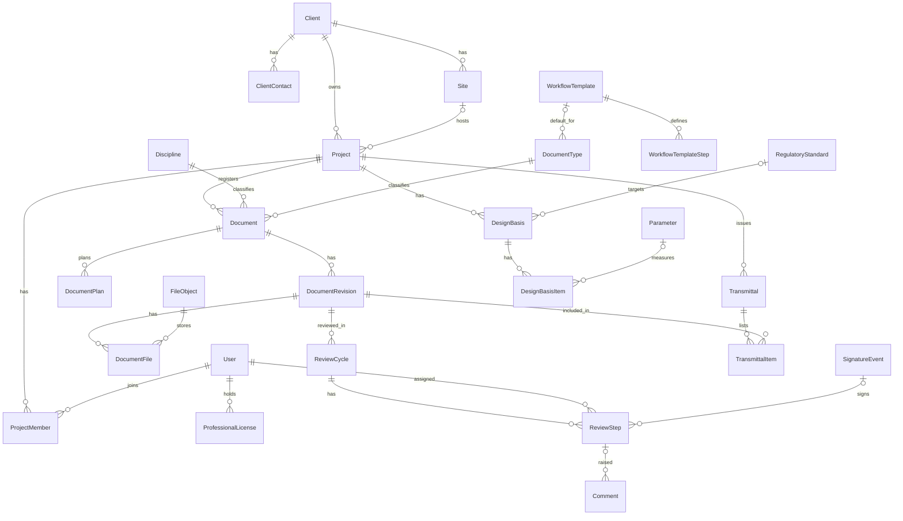
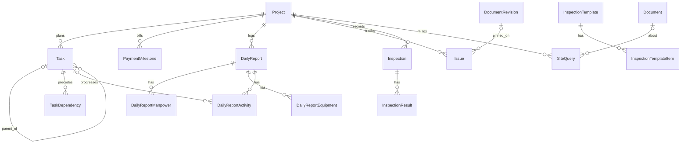
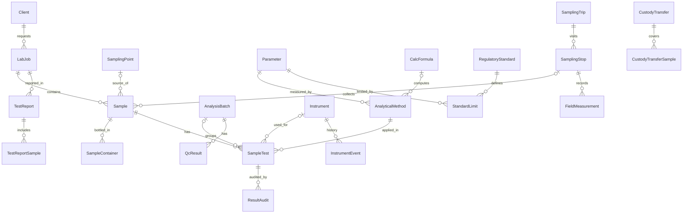
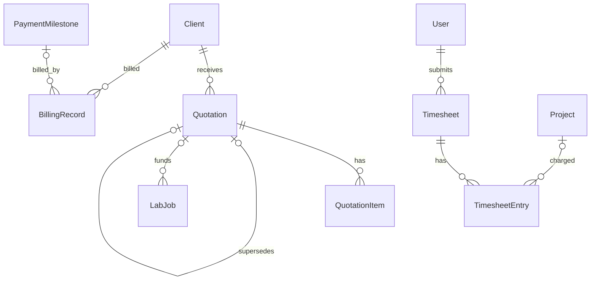

# 03 · Data model

> **แหล่งความจริง:** `apps/api/prisma/schema/*.prisma` (multi-file schema, Prisma 7) — เอกสารนี้อธิบาย convention และเหตุผล ไม่ได้ลอก schema ทั้งหมด
> schema ชุดนี้ผ่าน `prisma validate` แล้ว: 87 models, 77 enums

## 1. ไฟล์และคำสั่ง

| ไฟล์ | โมดูล |
|---|---|
| `base.prisma` | generator + datasource |
| `core.prisma` | M01 Platform |
| `crm.prisma` | M02 ลูกค้า สถานที่ จุดเก็บตัวอย่าง |
| `project.prisma` | M03 โครงการ |
| `document.prisma` | M04 งานออกแบบและเอกสาร ★ |
| `site.prisma` | M05 หน้างาน |
| `lab.prisma` | M06 LIMS |
| `sampling.prisma` | M07 เก็บตัวอย่าง |
| `commercial.prisma` | M08 ขายและการเงิน |

คำสั่ง (รันใน `apps/api`):

```bash
pnpm prisma validate                         # ตรวจ schema
pnpm prisma migrate dev --name <ชื่อ>        # สร้าง + ใช้ migration (dev)
pnpm prisma migrate dev --create-only --name <ชื่อ>   # สร้างไฟล์ SQL เพื่อแก้เองก่อนใช้
pnpm prisma generate                         # สร้าง client ที่ src/generated/prisma
pnpm prisma db seed                          # seed (Prisma 7 ไม่ seed อัตโนมัติ)
pnpm prisma migrate deploy                   # production
```

**Migration แรก (เฟส 0) ต้องแก้มือหนึ่งจุด:** schema มี GIN index แบบ `gin_trgm_ops` ซึ่งต้องมี extension `pg_trgm` ก่อน ให้สร้างด้วย `--create-only` แล้วเพิ่มบรรทัดนี้ไว้บนสุดของ `migration.sql`:

```sql
CREATE EXTENSION IF NOT EXISTS pg_trgm;
```

**การสร้างตารางทั้งหมดตั้งแต่เฟส 0:** schema ครอบคลุมทุกเฟสเพื่อให้ความสัมพันธ์ข้ามโมดูลถูกออกแบบครั้งเดียว migration แรกจึงสร้างทุกตาราง ตารางของเฟสหลังจะว่างไว้ก่อน และปรับด้วย migration ใหม่เมื่อถึงเฟสนั้น **ห้ามสร้าง API/หน้าจอของโมดูลที่ยังไม่ถึงเฟส** (ดู `10-roadmap.md`)

## 2. Naming convention

| สิ่ง | รูปแบบ | ตัวอย่าง |
|---|---|---|
| Model | PascalCase เอกพจน์ | `DocumentRevision` |
| ตาราง | snake_case พหูพจน์ ผ่าน `@@map` | `document_revisions` |
| ฟิลด์ | camelCase ใน Prisma, snake_case ใน DB ผ่าน `@map` (ทุกฟิลด์ที่มีหลายคำ) | `revLabel` → `rev_label` |
| Enum | PascalCase, ค่าเป็น SCREAMING_SNAKE | `RevisionStatus.IN_REVIEW` |
| FK | `<relation>Id` | `preparedById` |
| Relation หลายเส้นระหว่าง model คู่เดียวกัน | ตั้งชื่อ `@relation("<Model><Role>")` | `"RevisionApprovedBy"` |
| Index ชื่อเอง | `<table>_<cols>_<kind>_idx` | `documents_title_trgm_idx` |

เพิ่มฟิลด์ใหม่ต้องมี `@map` ถ้าชื่อมีหลายคำ และต้องเพิ่มป้ายใน `docs/data/enum-labels.json` ถ้าเพิ่ม enum/ค่า enum (CI ตรวจ)

## 3. คอลัมน์มาตรฐาน

| คอลัมน์ | ชนิด | กติกา |
|---|---|---|
| `id` | `String @db.Uuid` | ค่าเริ่มต้น `@default(uuid(7))` (UUIDv7 เรียงตามเวลา) — **ยกเว้น** model ที่มือถือสร้างออฟไลน์ (ตารางใน §10 คอลัมน์ "id จาก client") ไม่มีค่าเริ่มต้น client ต้องส่ง UUIDv7 มาเอง |
| `createdAt` / `updatedAt` | `Timestamptz(3)` | `@default(now())` / `@updatedAt` |
| `deletedAt` | `Timestamptz(3)?` | soft delete (§5) |
| `version` | `Int @default(1)` | optimistic locking (§6) |
| `createdById` ฯลฯ | `String? @db.Uuid` | อ้างอิงผู้ใช้แบบหลวม (§7) |

ตรวจ id ที่ client ส่งมา: ต้องเป็น UUID version 7 ที่ถูกรูปแบบ, ช่วงเวลาใน UUID ห่างจากเวลาปัจจุบันไม่เกิน 30 วัน, และถ้ามีแถว id นี้อยู่แล้วต้องเป็นของผู้ใช้คนเดียวกัน (กรณีส่งซ้ำ = idempotent คืนแถวเดิม)

## 4. ชนิดข้อมูล

| ข้อมูล | ชนิดใน DB | ใน API (JSON) | กติกา |
|---|---|---|---|
| เงิน | `Decimal(14,2)` | string `"1234.50"` | คำนวณด้วย `Prisma.Decimal` เท่านั้น ห้ามแปลงเป็น `number` |
| ผลวิเคราะห์/ค่าวัด | `Decimal(24,10)` | string | ปัดเศษตาม `AnalyticalMethod` ตอนสร้าง `resultText` |
| พิกัด | `Decimal(9,6)` | string | WGS84 |
| วันเวลา | `Timestamptz(3)` | ISO 8601 UTC `"2026-09-26T03:15:00.000Z"` | แสดงผลเป็น Asia/Bangkok |
| วันที่อย่างเดียว | `Date` | `"2026-09-26"` | serialize ด้วย transformer เฉพาะ ห้ามผ่าน timezone |
| JSON | `Json` | object | ทุกฟิลด์ Json ต้องมี zod schema ใน `src/common/json-schemas/` และตรวจก่อนเขียน |
| รายการ | `String[]` / `String[] @db.Uuid` | array | |

รูปร่างของฟิลด์ Json หลัก:

```ts
// Comment.anchor, Issue.drawingAnchor — พิกัด normalize 0..1 จากมุมซ้ายบนของหน้า
type PdfAnchor = { page: number; x: number; y: number; w?: number; h?: number; kind: 'PIN' | 'RECT' };

// CalcFormula.inputs / validations
type FormulaInput = { key: string; label: string; unit?: string; required: boolean };
type FormulaValidation = { expr: string; message: string; severity: 'ERROR' | 'WARNING' };

// SampleTest.rawData — key ตาม CalcFormula.inputs
type RawData = Record<string, number | string | null>;

// AuditLog.changes — เฉพาะฟิลด์ที่เปลี่ยน
type AuditChanges = { before: Record<string, unknown>; after: Record<string, unknown> };

// Sample.baselineValues — ค่าพื้นฐานต่อ Parameter.code
type BaselineValues = Record<string, number>;
```

## 5. Soft delete และการห้ามลบ

- model ที่มี `deletedAt`: การลบ = ตั้ง `deletedAt` ทุก query ต้องกรอง `deletedAt: null` ผ่าน helper `notDeleted()` ใน `src/common/prisma/`
- **ห้ามลบจริง (hard delete)** ในข้อมูลที่เป็นหลักฐาน: `Document`, `DocumentRevision`, `DocumentFile`, `FileObject`, `ReviewCycle`, `ReviewStep`, `SignatureEvent`, `Transmittal*`, `AuditLog`, `SampleTest`, `ResultAudit`, `TestReport`, `CustodyTransfer` — ใช้สถานะ VOID/CANCELLED แทน
- ข้อยกเว้นเดียว: revision ร่างที่**ไม่เคยส่งตรวจ** ทิ้งได้จริง (BR-DOC-025) เพื่อคืน revision label; `FileObject` ที่ผูกอยู่ถูกตั้ง `DELETED` โดยงาน cleanup
- ค่า unique (เช่น `Client.code`) ไม่ถูกปล่อยคืนเมื่อ soft delete

## 6. Optimistic locking

ทุก model ที่มี `version`:

```ts
const res = await tx.document.updateMany({
  where: { id, version: dto.version, deletedAt: null },
  data: { ...changes, version: { increment: 1 } },
});
if (res.count === 0) throw new ConflictProblem('CONFLICT_STALE_VERSION');
```

- response ทุกตัวคืน `version`; client ส่ง `version` กลับมาใน body ของ `PATCH`/action
- การเปลี่ยนสถานะ (action endpoint) ก็ต้องตรวจ `version` เช่นกัน

## 7. การอ้างอิงแบบหลวม (ไม่มี FK)

เพื่อลดความซับซ้อนของ relation ฟิลด์ต่อไปนี้เก็บ UUID โดยไม่มี FK:
- `*FileId` เกือบทั้งหมด (ยกเว้น `DocumentFile.fileId`, `Attachment.fileId` ที่มี relation) — `FilesService.assertUsable(fileId, userId)` ตรวจว่าไฟล์มีอยู่ สถานะ AVAILABLE และผู้ใช้เป็นคนอัปโหลดหรือมีสิทธิ์
- `createdById`, `verifiedById`, `voidedById`, `acknowledgedById`, `recordedById`, `grantedById`, `addedById`, `updatedById`, `approvedById` ในบาง model (ดู schema) — ชื่อผู้ใช้แสดงผ่าน user directory cache ฝั่ง client (`GET /users/directory`)
- `AuditLog`, `ChangeLog`, `OutboxEvent`, `Notification.entityId`, `Attachment.ownerId`, `Comment.ownerId` (polymorphic)

## 8. Audit, change log, outbox — เขียนใน transaction เดียวกัน

| ตาราง | เขียนเมื่อ | ใครอ่าน |
|---|---|---|
| `audit_logs` | ทุก create/update/delete/action ของข้อมูลธุรกิจ, auth event, ดาวน์โหลดไฟล์ CONFIDENTIAL, การลงนาม | หน้า Audit (admin), รายงานตรวจสอบ |
| `change_logs` | ทุกการเปลี่ยนแปลงของ entity ที่ sync ลงมือถือ | `GET /sync/pull` |
| `outbox_events` | ทุกเหตุการณ์ที่มี side effect | outbox relay (worker) |

`scopeKey` ของ change log:

| Entity | scopeKey |
|---|---|
| Project, ProjectMember (`entityId` = userId ของสมาชิก), Document, DocumentRevision, DocumentFile, DailyReport*, Issue, Inspection*, SiteQuery | `project:<projectId>` |
| ReviewStep ที่มอบหมายให้ผู้ใช้, Notification | `user:<userId>` |
| Discipline, DocumentType, Parameter, RegulatoryStandard, StandardLimit, AnalyticalMethod, TestPackage, InspectionTemplate | `global` |
| SamplingTrip, SamplingStop, Sample (จากภาคสนาม), FieldMeasurement | `trip:<tripId>` |

## 9. ความสัมพันธ์หลัก

### เฟส 0–1 (Platform + ลูกค้า + โครงการ + เอกสาร)



`Document` มีตัวชี้ 2 ตัวไปยัง revision: `currentRevisionId` (ล่าสุดที่ไม่ VOID) และ `latestApprovedRevisionId` (ฉบับใช้งาน) — อัปเดตโดย `RevisionsService` เท่านั้น ใน transaction เดียวกับการเปลี่ยนสถานะ

### เฟส 2 (หน้างาน)



### เฟส 3 (แล็บและเก็บตัวอย่าง)



### เฟส 4 (ขายและการเงิน)



## 10. ตารางทั้งหมด

| ไฟล์ | Model | ตาราง | เฟส | soft delete | version | id จาก client |
|---|---|---|---|---|---|---|
| core | `Attachment` | `attachments` | 0 | ✔ |  |  |
| core | `AuditLog` | `audit_logs` | 0 |  |  |  |
| core | `ChangeLog` | `change_logs` | 0 |  |  |  |
| core | `Comment` | `comments` | 0 | ✔ | ✔ |  |
| core | `Department` | `departments` | 0 |  |  |  |
| core | `FileObject` | `file_objects` | 0 | ✔ |  |  |
| core | `IdempotencyRecord` | `idempotency_records` | 0 |  |  |  |
| core | `Notification` | `notifications` | 0 |  |  |  |
| core | `NotificationPreference` | `notification_preferences` | 0 |  |  |  |
| core | `NumberSequence` | `number_sequences` | 0 |  |  |  |
| core | `NumberingScheme` | `numbering_schemes` | 0 |  |  |  |
| core | `OutboxEvent` | `outbox_events` | 0 |  |  |  |
| core | `ProfessionalLicense` | `professional_licenses` | 0 |  |  |  |
| core | `PushDevice` | `push_devices` | 0 |  |  |  |
| core | `Role` | `roles` | 0 |  |  |  |
| core | `RolePermission` | `role_permissions` | 0 |  |  |  |
| core | `Session` | `sessions` | 0 |  |  |  |
| core | `Setting` | `settings` | 0 |  |  |  |
| core | `SignatureEvent` | `signature_events` | 0 |  |  |  |
| core | `User` | `users` | 0 | ✔ | ✔ |  |
| core | `UserRole` | `user_roles` | 0 |  |  |  |
| crm | `Client` | `clients` | 1 | ✔ | ✔ |  |
| crm | `ClientContact` | `client_contacts` | 1 | ✔ | ✔ |  |
| crm | `SamplingPoint` | `sampling_points` | 3 | ✔ | ✔ |  |
| crm | `Site` | `sites` | 1 | ✔ | ✔ |  |
| project | `PaymentMilestone` | `payment_milestones` | 2 |  | ✔ |  |
| project | `Project` | `projects` | 1 | ✔ | ✔ |  |
| project | `ProjectMember` | `project_members` | 1 |  |  |  |
| project | `Task` | `tasks` | 2 | ✔ | ✔ |  |
| project | `TaskAssignee` | `task_assignees` | 2 |  |  |  |
| project | `TaskDependency` | `task_dependencies` | 2 |  |  |  |
| document | `DesignBasis` | `design_bases` | 1 |  | ✔ |  |
| document | `DesignBasisItem` | `design_basis_items` | 1 |  |  |  |
| document | `Discipline` | `disciplines` | 1 |  |  |  |
| document | `Document` | `documents` | 1 | ✔ | ✔ |  |
| document | `DocumentFile` | `document_files` | 1 |  |  |  |
| document | `DocumentPlan` | `document_plans` | 1 |  |  |  |
| document | `DocumentRevision` | `document_revisions` | 1 |  | ✔ |  |
| document | `DocumentType` | `document_types` | 1 |  |  |  |
| document | `ReviewCycle` | `review_cycles` | 1 |  | ✔ |  |
| document | `ReviewStep` | `review_steps` | 1 |  | ✔ |  |
| document | `Transmittal` | `transmittals` | 1 |  | ✔ |  |
| document | `TransmittalDownload` | `transmittal_downloads` | 1 |  |  |  |
| document | `TransmittalItem` | `transmittal_items` | 1 |  |  |  |
| document | `WorkflowTemplate` | `workflow_templates` | 1 |  |  |  |
| document | `WorkflowTemplateStep` | `workflow_template_steps` | 1 |  |  |  |
| site | `DailyReport` | `daily_reports` | 2 | ✔ | ✔ | ✔ |
| site | `DailyReportActivity` | `daily_report_activities` | 2 |  |  | ✔ |
| site | `DailyReportEquipment` | `daily_report_equipment` | 2 |  |  | ✔ |
| site | `DailyReportManpower` | `daily_report_manpower` | 2 |  |  | ✔ |
| site | `Inspection` | `inspections` | 2 |  | ✔ | ✔ |
| site | `InspectionResult` | `inspection_results` | 2 |  |  | ✔ |
| site | `InspectionTemplate` | `inspection_templates` | 2 |  |  |  |
| site | `InspectionTemplateItem` | `inspection_template_items` | 2 |  |  |  |
| site | `Issue` | `issues` | 2 | ✔ | ✔ | ✔ |
| site | `SiteQuery` | `site_queries` | 2 |  | ✔ | ✔ |
| lab | `AnalysisBatch` | `analysis_batches` | 3 |  | ✔ |  |
| lab | `AnalyticalMethod` | `analytical_methods` | 3 |  |  |  |
| lab | `CalcFormula` | `calc_formulas` | 3 |  |  |  |
| lab | `CustodyTransfer` | `custody_transfers` | 3 |  |  | ✔ |
| lab | `CustodyTransferSample` | `custody_transfer_samples` | 3 |  |  |  |
| lab | `Instrument` | `instruments` | 3 |  | ✔ |  |
| lab | `InstrumentEvent` | `instrument_events` | 3 |  |  |  |
| lab | `LabJob` | `lab_jobs` | 3 | ✔ | ✔ |  |
| lab | `Parameter` | `parameters` | 1 (seed) |  |  |  |
| lab | `QcCriterion` | `qc_criteria` | 3 |  |  |  |
| lab | `QcResult` | `qc_results` | 3 |  |  |  |
| lab | `RegulatoryStandard` | `regulatory_standards` | 1 (seed) |  |  |  |
| lab | `ResultAudit` | `result_audits` | 3 |  |  |  |
| lab | `Sample` | `samples` | 3 |  | ✔ | ✔ |
| lab | `SampleContainer` | `sample_containers` | 3 |  |  | ✔ |
| lab | `SampleTest` | `sample_tests` | 3 |  | ✔ |  |
| lab | `StandardLimit` | `standard_limits` | 1 (seed) |  |  |  |
| lab | `TestPackage` | `test_packages` | 3 |  |  |  |
| lab | `TestPackageItem` | `test_package_items` | 3 |  |  |  |
| lab | `TestReport` | `test_reports` | 3 |  | ✔ |  |
| lab | `TestReportSample` | `test_report_samples` | 3 |  |  |  |
| sampling | `FieldMeasurement` | `field_measurements` | 3 |  |  | ✔ |
| sampling | `SamplingStop` | `sampling_stops` | 3 |  | ✔ |  |
| sampling | `SamplingTrip` | `sampling_trips` | 3 |  | ✔ |  |
| sampling | `SamplingTripMember` | `sampling_trip_members` | 3 |  |  |  |
| commercial | `BillingRecord` | `billing_records` | 4 |  | ✔ |  |
| commercial | `CostRate` | `cost_rates` | 4 |  |  |  |
| commercial | `Quotation` | `quotations` | 4 | ✔ | ✔ |  |
| commercial | `QuotationItem` | `quotation_items` | 4 |  |  |  |
| commercial | `Timesheet` | `timesheets` | 4 |  | ✔ |  |
| commercial | `TimesheetEntry` | `timesheet_entries` | 4 |  |  |  |

## 11. ข้อมูลตั้งต้น (seed)

ไฟล์อยู่ใน `docs/data/seed/` — `prisma/seed/seed.ts` อ่าน CSV/JSON เหล่านี้ (upsert ด้วย `code` จึงรันซ้ำได้)

| ลำดับ | ไฟล์ | ตาราง | เฟส |
|---|---|---|---|
| 1 | `roles.json` | `roles`, `role_permissions` | 0 |
| 2 | `numbering-schemes.csv` | `numbering_schemes` | 0 |
| 3 | `settings.json` | `settings` | 0 |
| 4 | `disciplines.csv` | `disciplines` | 1 |
| 5 | `workflow-templates.json` | `workflow_templates`, `workflow_template_steps` | 1 |
| 6 | `document-types.csv` | `document_types` | 1 |
| 7 | `parameters.csv` | `parameters` (+ `analytical_methods` ตั้งต้นในเฟส 3) | 1 |
| 8 | `standards.csv` | `regulatory_standards`, `standard_limits` | 1 |
| 9 | `calc-formulas.json` | `calc_formulas` | 3 |
| dev | `prisma/seed/demo.ts` | ผู้ใช้ตัวอย่างทุกบทบาท ลูกค้า โครงการ เอกสารหลายสถานะ | 0–1 (ห้ามรันใน production) |

ผู้ดูแลระบบคนแรกสร้างด้วยคำสั่ง `pnpm --filter api cli create-admin --email ... --name ...` (ไม่ seed รหัสผ่านไว้ในไฟล์)
