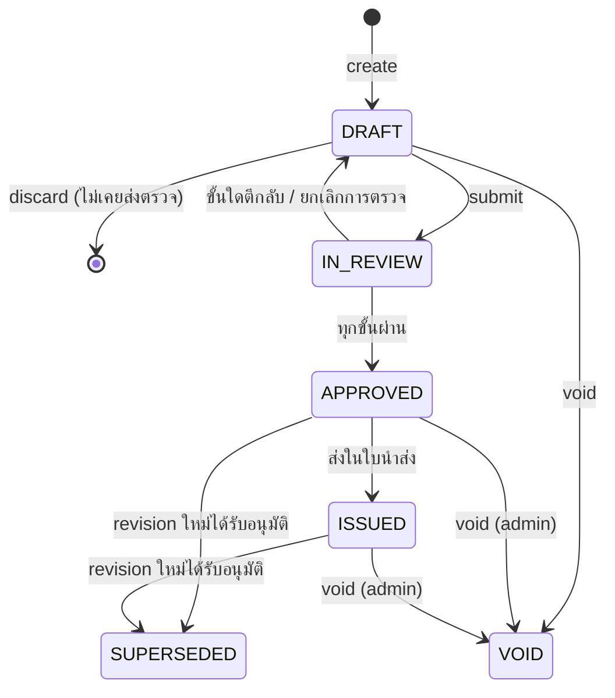
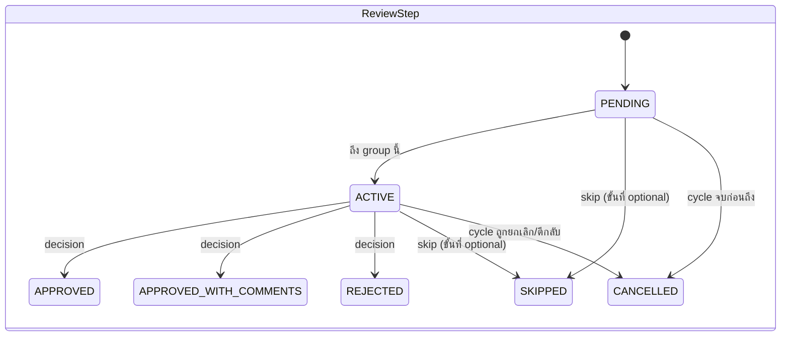
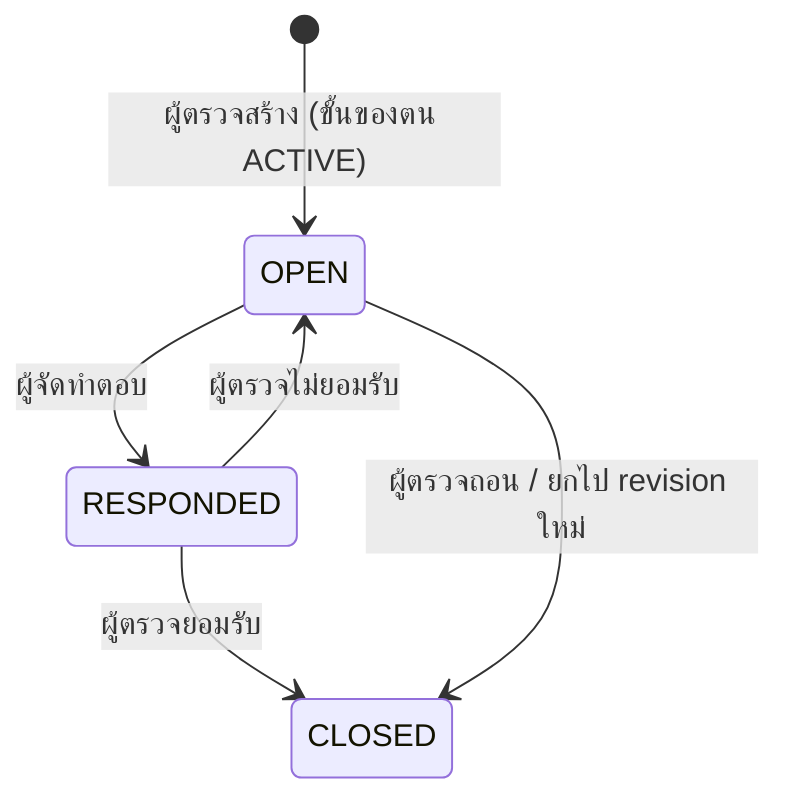
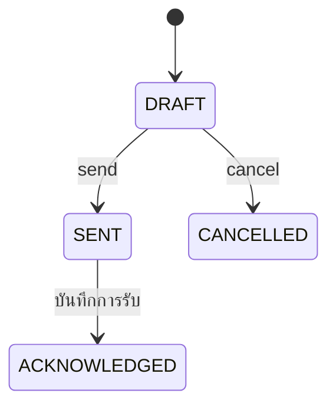
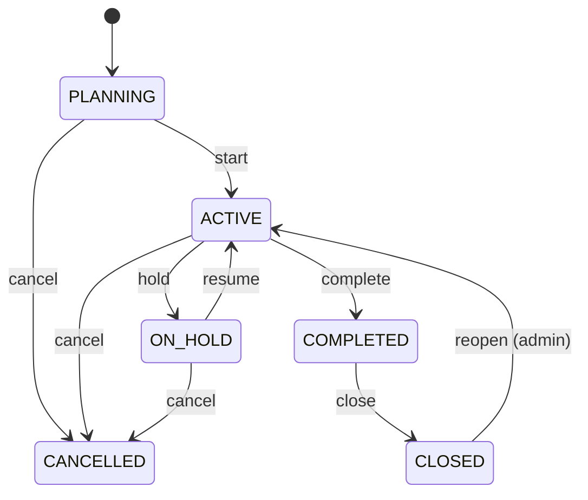
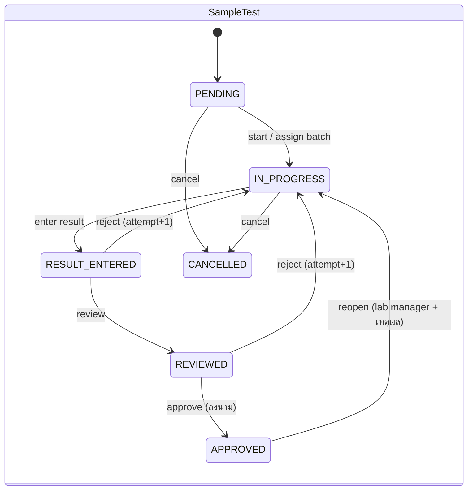

# 05 · Workflow และ state machine

> กติกาการเปลี่ยนสถานะของทุก entity อยู่ที่นี่ที่เดียว ชื่อสถานะตรงกับ enum ใน Prisma
> Implement เป็น pure function ใน `src/modules/<module>/domain/*-state-machine.ts` → `assertTransition(from, action, ctx)` และมี unit test ครบทุกแถวของตาราง (ชื่อ test ขึ้นต้นด้วยรหัส BR)
> ทุก transition: ตรวจ `version` → เปลี่ยนสถานะ → เขียน `AuditLog` (action = `<entity>.<action>`) → `ChangeLog` → `OutboxEvent` ใน transaction เดียว

## 1. Revision ของเอกสาร (`RevisionStatus`) ★ MVP

| จาก | Action (endpoint) | ไป | ผู้ทำ | เงื่อนไข (guard) | ผลข้างเคียง / event |
|---|---|---|---|---|---|
| – | create `POST /documents/{id}/revisions` | DRAFT | `document.edit` | เอกสาร ACTIVE; โครงการ PLANNING/ACTIVE; ไม่มี revision อื่นใน DRAFT/IN_REVIEW (BR-DOC-021) | คำนวณ label (BR-DOC-020/022); `Document.currentRevisionId`; ยกความเห็นค้าง (BR-DOC-034); `revision.created` |
| DRAFT | upload `POST /revisions/{id}/files` | DRAFT | ผู้จัดทำ หรือ `document.edit` | ไฟล์ AVAILABLE; ชนิดตรง role (BR-DOC-026) | DocumentFile ใหม่ `uploadVersion+1`, ตัวเดิม `isCurrent=false` |
| DRAFT | discard `DELETE /revisions/{id}` | (ลบ) | ผู้จัดทำ หรือ `document.admin` | ไม่เคยมี ReviewCycle และไม่มีความเห็น (BR-DOC-025) | คืน label; ชี้ `currentRevisionId` กลับ; `revision.discarded` |
| DRAFT | submit `POST /revisions/{id}/submit` | IN_REVIEW | ผู้จัดทำ หรือ `document.edit` | BR-DOC-030, 040–042 | สร้าง ReviewCycle + steps, group แรก ACTIVE; `lockedAt`; `revision.submitted`, `review.step.activated` × n |
| IN_REVIEW | (ระบบ) ทุก group ผ่าน | APPROVED | ระบบ | – | `approvedAt`, `approvedById`, `checkedById`; `Document.latestApprovedRevisionId`; revision APPROVED/ISSUED เดิม → SUPERSEDED; `revision.approved` |
| IN_REVIEW | (ระบบ) มีขั้นตีกลับ | DRAFT | ระบบ | – | cycle REJECTED; ปลด `lockedAt`; `lastCycleOutcome=REJECTED`; `revision.rejected` |
| IN_REVIEW | cancel-review `POST /revisions/{id}/cancel-review` | DRAFT | ผู้ส่งตรวจ, PM ของโครงการ, `document.admin` | ระบุเหตุผล | cycle CANCELLED, steps ที่ค้าง CANCELLED; `review.cycle.cancelled` |
| APPROVED | (ระบบ) ใบนำส่ง SENT | ISSUED | ระบบ | – | `issuedAt` (ครั้งแรก) |
| APPROVED, ISSUED | (ระบบ) revision ใหม่ APPROVED | SUPERSEDED | ระบบ | – | `revision.superseded` → แจ้งผู้ที่ปักหมุดออฟไลน์ |
| DRAFT | void `POST /revisions/{id}/void` | VOID | ผู้จัดทำ, `document.admin` | ไม่เข้าเงื่อนไข discard (BR-DOC-025); ระบุเหตุผล | ชี้ `currentRevisionId` กลับ revision ก่อนหน้าที่ไม่ VOID |
| APPROVED, ISSUED | void | VOID | `document.admin` เท่านั้น | ระบุเหตุผล; ถ้า ISSUED ต้องยืนยันซ้ำ | คำนวณ `latestApprovedRevisionId` ใหม่; แจ้ง PM + ผู้รับใบนำส่งภายใน |

## 2. รอบการตรวจ (`ReviewCycleStatus`) และขั้นตอน (`ReviewStepStatus`) ★ MVP

| จาก | Action | ไป | ผู้ทำ | เงื่อนไข | ผลข้างเคียง |
|---|---|---|---|---|---|
| PENDING | (ระบบ) group ก่อนหน้าครบ | ACTIVE | ระบบ | BR-DOC-031 | `activatedAt`, `dueAt` (BR-DOC-036); `review.step.activated` |
| ACTIVE | decision `POST /review-steps/{id}/decision` `{decision:"APPROVED", version, signature?}` | APPROVED | assignee เท่านั้น | BR-DOC-039, 040, 042, 043 | SignatureEvent (ถ้าต้องลงนาม); ตรวจ group ครบ → เปิด group ถัดไป หรือ cycle APPROVED |
| ACTIVE | decision `APPROVED_WITH_COMMENTS` | APPROVED_WITH_COMMENTS | assignee | + มีความเห็นจากขั้นนี้ ≥ 1 ข้อ (BR-DOC-033) | เหมือนข้างบน |
| ACTIVE | decision `REJECTED` | REJECTED | assignee | มี `note` หรือความเห็น OPEN จากขั้นนี้ (BR-DOC-033) | cycle REJECTED, ขั้นอื่นที่ค้าง CANCELLED, revision → DRAFT (BR-DOC-032) |
| ACTIVE, PENDING | reassign `POST /review-steps/{id}/reassign` `{assigneeId, reason}` | (เดิม) | assignee (มอบต่อ), PM, `document.admin` | ผู้รับใหม่ผ่าน BR-DOC-041/042 | `delegatedFromUserId`; `review.step.reassigned` |
| PENDING, ACTIVE | skip `POST /review-steps/{id}/skip` `{reason}` | SKIPPED | PM, `document.admin` | `isOptional = true` | ตรวจ group ครบ |

ReviewCycle: `IN_PROGRESS` → `APPROVED` (ทุก group ผ่าน) | `REJECTED` (มีขั้นตีกลับ) | `CANCELLED` (cancel-review หรือ revision ถูก void)

## 3. ความเห็นจากการตรวจ (`CommentStatus`) ★ MVP

- ความเห็นทั่วไป (`NONE`) ไม่มี workflow
- ปิดความเห็นได้โดย: ผู้เขียนความเห็น หรือ `document.admin`
- สร้าง revision ใหม่: ความเห็น OPEN/RESPONDED ถูกคัดลอกเป็น OPEN ใน revision ใหม่ และตัวเดิมถูกปิดอัตโนมัติ (BR-DOC-034)

## 4. ใบนำส่ง (`TransmittalStatus`) ★ MVP

| จาก | Action | ไป | ผู้ทำ | เงื่อนไข | ผลข้างเคียง |
|---|---|---|---|---|---|
| DRAFT | แก้หัว/รายการ `PATCH`, `POST/DELETE .../items` | DRAFT | `transmittal.manage` | BR-DOC-060 | – |
| DRAFT | send `POST /transmittals/{id}/send` | SENT | `transmittal.manage` | มีรายการ ≥ 1; ผ่าน BR-DOC-060; มีผู้รับอีเมล (ถ้าส่งทางอีเมล) | ออกเลข (ถ้ายังไม่มี); revision APPROVED → ISSUED; DocumentPlan.actualDate (BR-DOC-063); `transmittal.sent` → worker สร้างใบนำส่ง PDF / ZIP / ลิงก์ แล้วส่งอีเมล |
| DRAFT | cancel | CANCELLED | `transmittal.manage` | – | – |
| SENT | acknowledge `POST /transmittals/{id}/acknowledge` | ACKNOWLEDGED | `transmittal.manage` | วันที่รับ ≥ วันที่ส่ง | – |
| SENT, ACKNOWLEDGED | client-response `POST /transmittal-items/{id}/client-response` | (เดิม) | `transmittal.manage` | – | อัปเดต `DocumentRevision.clientReturnCode`; CODE_3/CODE_4 → `transmittal.client_response_recorded` (BR-DOC-064) |
| SENT, ACKNOWLEDGED | revoke-link / extend-link / resend-email | (เดิม) | `transmittal.manage` | deliveryMethod = EMAIL_LINK (สำหรับลิงก์) | – |

ใบนำส่งที่ SENT แล้ว **แก้ไม่ได้** — ถ้าผิดให้ออกใบใหม่ (BR-DOC-066)

## 5. Design basis (`DesignBasisStatus`) — MVP

`DRAFT` → approve (`designbasis.approve`) → `APPROVED` → (มี revNo ใหม่ APPROVED) → `SUPERSEDED`
สร้าง revNo ใหม่ได้เมื่อไม่มี DRAFT ค้าง โดยคัดลอกรายการจากฉบับล่าสุด (BR-DOC-080–082)

## 6. โครงการ (`ProjectStatus`)

- เปลี่ยนสถานะโครงการ: `project.manage` หรือ PM ของโครงการ; reopen/cancel ต้องระบุเหตุผล
- ผลต่อเอกสาร: ON_HOLD, COMPLETED = สร้าง/ส่งตรวจ revision ไม่ได้ แต่ส่งใบนำส่งฉบับ As-built ได้ใน COMPLETED; CLOSED, CANCELLED = อ่านอย่างเดียว (BR-PRJ-020)
- close ได้เมื่อ: ไม่มี ReviewCycle IN_PROGRESS และไม่มีใบนำส่ง DRAFT (BR-PRJ-021)

## 7. เฟส 2 — หน้างาน

| Entity | Transition หลัก | ผู้ทำ |
|---|---|---|
| `DailyReport` | DRAFT → SUBMITTED (submit) → APPROVED (approve) ; SUBMITTED → RETURNED (return + เหตุผล) → SUBMITTED | ผู้สร้าง / `dailyreport.approve` (PM) |
| `Issue` | OPEN → IN_PROGRESS → RESOLVED (assignee + resolutionNote + รูปหลังแก้) → VERIFIED (ผู้แจ้ง/`issue.manage`) → CLOSED ; RESOLVED → OPEN (reopen) ; OPEN/IN_PROGRESS → CANCELLED (`issue.manage` + เหตุผล) | ตามคอลัมน์ |
| `Inspection` | DRAFT → SUBMITTED → APPROVED / REJECTED | ผู้ตรวจ / `inspection.approve` |
| `SiteQuery` | OPEN → ANSWERED (`sitequery.answer`) → CLOSED (ผู้ถาม) ; OPEN → CANCELLED | ตามคอลัมน์ |
| `Task` | NOT_STARTED → IN_PROGRESS (progress > 0) → COMPLETED (progress = 100) ; ON_HOLD / CANCELLED โดย `task.manage` | อัตโนมัติจาก progress + PM |
| `PaymentMilestone` | PENDING → SUBMITTED → ACCEPTED → INVOICED → PAID ; CANCELLED | `milestone.manage` |

DailyReport ที่ APPROVED แก้ไม่ได้; ความคืบหน้าใน activity ถูกเขียนลง Task ตอน approve เท่านั้น

## 8. เฟส 3 — แล็บและเก็บตัวอย่าง

| Entity | Transition หลัก | กติกาสำคัญ |
|---|---|---|
| `LabJob` | DRAFT → OPEN → IN_PROGRESS (ตัวอย่างแรกเริ่มวิเคราะห์) → COMPLETED (ทุกตัวอย่าง ANALYSIS_COMPLETE/CANCELLED) → REPORTED (ออกรายงาน) → CLOSED ; → CANCELLED | อัตโนมัติจากตัวอย่าง ยกเว้น OPEN, CLOSED, CANCELLED |
| `Sample` | REGISTERED → RECEIVED (receive + ตรวจสภาพ) → IN_ANALYSIS → ANALYSIS_COMPLETE → REPORTED → DISPOSED ; REGISTERED → REJECTED ; → CANCELLED | รับตัวอย่างเกิน holding time → ACCEPTED_WITH_DEVIATION หรือ REJECTED (BR-LAB-011) |
| `SampleTest` | ตามแผนภาพ | ผู้ review ≠ ผู้บันทึกผล, ผู้อนุมัติ ≠ ผู้บันทึกผล (BR-LAB-040); ทุกการแก้หลัง RESULT_ENTERED ต้องมีเหตุผลและเขียน `ResultAudit` |
| `AnalysisBatch` | OPEN → COMPLETED → APPROVED ; COMPLETED → QC_FAILED (QC ไม่ผ่าน → ผลใน batch กลับ IN_PROGRESS) | อนุมัติ batch ได้เมื่อ QC ผ่านทุกข้อ (BR-LAB-031) |
| `TestReport` | DRAFT → IN_REVIEW → ISSUED (ลงนามผู้มีอำนาจ) → SUPERSEDED (มีฉบับแก้ไข) ; DRAFT → CANCELLED | ออกได้เมื่อรายการทดสอบทั้งหมด APPROVED (BR-LAB-050) |
| `SamplingTrip` | PLANNED → IN_PROGRESS (เริ่มบนมือถือ) → COMPLETED (ทุก stop SAMPLED/SKIPPED และส่งมอบตัวอย่างแล้ว) ; → CANCELLED | |
| `SamplingStop` | PENDING → SAMPLED / SKIPPED (+ เหตุผล) | ต้องมี GPS และเวลาเก็บ (BR-SMP-010) |
| `Instrument` | IN_SERVICE ↔ OUT_OF_SERVICE → RETIRED | เลยกำหนดสอบเทียบ + `blockWhenOverdue` → ห้ามใช้บันทึกผล (BR-LAB-030) |

## 9. เฟส 4 — ขายและการเงิน

| Entity | Transition หลัก |
|---|---|
| `Quotation` | DRAFT → PENDING_APPROVAL (ถ้าเกินเกณฑ์ส่วนลด/มูลค่า) → APPROVED → SENT → ACCEPTED / REJECTED / EXPIRED (งานตามเวลา) ; DRAFT → APPROVED (ไม่เกินเกณฑ์); revise → ฉบับใหม่ DRAFT และฉบับเดิม SUPERSEDED ; → CANCELLED |
| `BillingRecord` | DRAFT → REQUESTED → INVOICED (ใส่ `externalRef`) → PAID ; → CANCELLED |
| `Timesheet` | DRAFT → SUBMITTED → APPROVED / REJECTED (→ แก้ → SUBMITTED) |

## 10. Outbox event และการแจ้งเตือน

| Event (`OutboxEvent.type`) | ผู้รับแจ้ง | ช่องทางเริ่มต้น | เฟส |
|---|---|---|---|
| `review.step.activated` | assignee | in-app, email, push | 1 |
| `review.step.reassigned` | assignee ใหม่ (+ แจ้งคนเดิม in-app) | in-app, email, push | 1 |
| `review.step.due_soon` / `review.step.overdue` | assignee; เกิน 2 วันทำการ + PM | in-app, email, push | 1 |
| `revision.approved` | ผู้จัดทำ, เจ้าของเอกสาร, DC ของโครงการ | in-app, push | 1 |
| `revision.rejected` | ผู้จัดทำ, เจ้าของเอกสาร | in-app, email, push | 1 |
| `revision.superseded` | ผู้ที่ปักหมุดเอกสารไว้ออฟไลน์ | push | 1 |
| `comment.created` (มี @mention) | ผู้ถูกกล่าวถึง | in-app, push | 1 |
| `comment.responded` | ผู้เขียนความเห็น | in-app | 1 |
| `transmittal.sent` | PM, DC ของโครงการ | in-app | 1 |
| `transmittal.email_failed` | ผู้ส่ง | in-app, email | 1 |
| `transmittal.client_response_recorded` (CODE_3/4) | เจ้าของเอกสาร, PM | in-app, email, push | 1 |
| `designbasis.approved` | สมาชิกโครงการบทบาท DESIGN_MANAGER/ENGINEER | in-app | 1 |
| `project.member_added` | ผู้ถูกเพิ่ม | in-app, email | 1 |
| `license.expiring` | เจ้าของใบอนุญาต, ADMIN | in-app, email | 1 |
| `file.uploaded` | (ไม่มีผู้รับ — worker ประมวลผลไฟล์) | – | 0 |
| `dailyreport.submitted` | PM ของโครงการ | in-app, push | 2 |
| `dailyreport.returned` / `dailyreport.approved` | ผู้รายงาน | in-app, push | 2 |
| `issue.assigned` / `issue.resolved` | assignee / ผู้แจ้ง | in-app, push | 2 |
| `sitequery.raised` / `sitequery.answered` | ผู้รับผิดชอบ / ผู้ถาม | in-app, email, push | 2 |
| `sample.received` | นักวิเคราะห์ที่ได้รับมอบหมาย | in-app | 3 |
| `sampletest.holding_time_warning` | นักวิเคราะห์, LAB_MANAGER | in-app, push | 3 |
| `sampletest.ready_for_review` / `sampletest.ready_for_approval` | ผู้มีสิทธิ์ review / approve | in-app | 3 |
| `batch.qc_failed` | นักวิเคราะห์, LAB_MANAGER | in-app, email | 3 |
| `testreport.issued` | ผู้ดูแลงาน (+ อีเมลลูกค้าเมื่อกดส่ง) | in-app | 3 |
| `instrument.calibration_due` | LAB_MANAGER | in-app, email | 3 |
| `quotation.approval_requested` / `approved` | ผู้อนุมัติ / ผู้จัดทำ | in-app, email | 4 |
| `timesheet.reminder` (ศุกร์ 16:00) | ผู้ที่ยังไม่ส่ง | in-app, push | 4 |

Event ที่ไม่มีผู้รับแจ้ง (ใช้กับ SSE, สถิติ และ handler อื่น): `document.created`, `revision.created`, `revision.submitted`, `revision.discarded`, `revision.voided`, `review.cycle.cancelled`

ผู้ใช้ปิด/เปิดช่องทางต่อ event ได้ที่ `NotificationPreference` ยกเว้น event ที่เป็นงานบังคับ (`review.step.activated`, `review.step.overdue`) ซึ่งปิด in-app ไม่ได้
