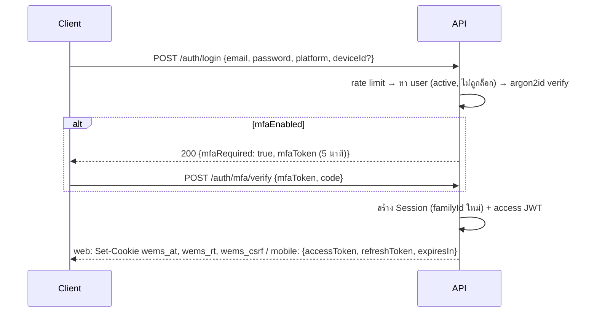

# 06 · ความปลอดภัย สิทธิ์ และ PDPA

## 1. บริบทความเสี่ยง

- ระบบเปิดสู่อินเทอร์เน็ต (มือถือใช้นอกสำนักงาน) แต่ผู้ใช้เป็นพนักงานเท่านั้น
- ข้อมูลสำคัญ: แบบวิศวกรรมของลูกค้า ผลวิเคราะห์ที่มีผลทางกฎหมาย ลายมือชื่อ/ใบอนุญาตวิศวกร ข้อมูลติดต่อลูกค้า
- ความเสียหายที่ต้องป้องกันมากที่สุด: (1) ใช้หรือส่งแบบผิดฉบับ (2) การอนุมัติโดยผู้ไม่มีสิทธิ์ (3) ผลแล็บถูกแก้โดยไม่มีร่องรอย (4) ข้อมูลลูกค้ารั่วผ่านลิงก์สาธารณะ
- เป้าหมายการควบคุม: OWASP ASVS ระดับ 2

## 2. การยืนยันตัวตน

### 2.1 Login

| กติกา | ค่า |
|---|---|
| รหัสผ่าน | ยาว ≥ 12 ตัว, ห้ามตรงกับอีเมล/ชื่อ, ตรวจกับรายการรหัสผ่านยอดนิยม 10,000 อันดับ (ไฟล์ในโค้ด), hash ด้วย argon2id (m=64MB, t=3, p=1) |
| ผิดติดต่อกัน | 10 ครั้ง → ล็อก 15 นาที (`lockedUntil`), แจ้งผู้ใช้ทางอีเมล |
| ข้อความผิดพลาด | ไม่บอกว่าอีเมลมีอยู่หรือไม่ (`INVALID_CREDENTIALS` เสมอ) |
| MFA (TOTP) | ทางเลือกสำหรับทุกคน **บังคับ** สำหรับบทบาท ADMIN; secret เข้ารหัส AES-256-GCM |
| ลืมรหัสผ่าน | ผู้ดูแลระบบตั้งรหัสชั่วคราว + `mustChangePassword` (เฟส 5: ลิงก์รีเซ็ตทางอีเมล) |
| SSO (เฟส 5) | OIDC กับ Microsoft Entra ID หรือ Google Workspace ผูกด้วยอีเมล; ผู้ใช้ SSO-only มี `passwordHash = null` |

### 2.2 Token และ session

| | Access token | Refresh token |
|---|---|---|
| รูปแบบ | JWT (HS256) `{ sub, sid, perms_ver, iat, exp }` | สุ่ม 32 ไบต์ base64url, เก็บเฉพาะ SHA-256 ใน `Session.refreshTokenHash` |
| อายุ | 15 นาที | เว็บ 7 วัน, มือถือ 30 วัน; idle เกิน setting `security.sessionIdleMinutes` (เว็บ) = หมดอายุ |
| หมุนเวียน | – | ทุก `/auth/refresh` ออกคู่ใหม่ แถวเดิม `revokedAt` + `replacedBySessionId` |
| ตรวจจับการขโมย | – | ใช้ refresh token ที่ถูกหมุนไปแล้ว → เพิกถอนทั้ง `familyId` + audit `auth.token_reuse_detected` + แจ้งผู้ใช้ |

- สิทธิ์ของผู้ใช้โหลดจาก DB/Redis cache ทุก request (key มี `perms_ver`) — เปลี่ยนบทบาทแล้วมีผลทันที ไม่ต้องรอ token หมดอายุ
- ผู้ใช้ดูและเพิกถอน session ของตนได้ (`GET /auth/sessions`, `DELETE /auth/sessions/{id}`); ADMIN เพิกถอนทุก session ของผู้ใช้ได้เมื่อปิดบัญชี
- ปิดบัญชี (`isActive = false`) → เพิกถอนทุก session ทันที

### 2.3 เว็บ: cookie และ CSRF

- cookie: `HttpOnly; Secure; SameSite=Lax`; `wems_rt` จำกัด `Path=/api/v1/auth`
- CSRF: double-submit — cookie `wems_csrf` (ไม่ HttpOnly) + header `X-CSRF-Token` ต้องตรงกันในทุก request ที่ไม่ใช่ GET/HEAD
- เว็บและ API อยู่โดเมนเดียวกัน จึงไม่ต้องเปิด CORS

### 2.4 มือถือ

- เก็บ refresh token ใน `flutter_secure_storage` (Keychain/Keystore); access token เก็บในหน่วยความจำ
- refresh แบบ single-flight (request ที่ 401 พร้อมกันรอ refresh ครั้งเดียว)
- ถ้า refresh ล้มเหลวด้วย 401 → ลบข้อมูลออฟไลน์ที่เป็นความลับ (ไฟล์ PDF ที่ปักหมุด, ฐานข้อมูล local) แล้วกลับหน้า login
- ตัวเลือก: ล็อกแอปด้วย biometric (`local_auth`) หลังอยู่เบื้องหลังเกิน 5 นาที

## 3. การกำหนดสิทธิ์ (Authorization)

### 3.1 หลักการ

1. **สิทธิ์ (permission)** มาจากบทบาทระบบ (global role) — ผู้ใช้มีได้หลายบทบาท สิทธิ์รวมกัน
2. **ขอบเขตโครงการ**: resource ที่อยู่ในโครงการ (เอกสาร ใบนำส่ง รายงานหน้างาน …) เข้าถึงได้เมื่อ
   `hasPermission(action) AND (isActiveMember(project) OR hasPermission("project.read_all"))`
3. **บทบาทในโครงการ (ProjectRole)** ใช้สำหรับ (ก) สิทธิ์จัดการโครงการนั้น — `project.manage` หรือเป็น `PROJECT_MANAGER` ของโครงการ (ข) จำกัดผู้ที่เลือกเป็นผู้ตรวจ/อนุมัติตามแม่แบบ workflow
4. **สถานะโครงการ** CLOSED/CANCELLED = อ่านอย่างเดียว ยกเว้น ADMIN
5. **ไม่มีสิทธิ์เห็น = 404** (ไม่บอกว่ามีอยู่); เห็นได้แต่ทำ action ไม่ได้ = 403
6. ตรวจสิทธิ์ที่ API เท่านั้น; client ใช้ `allowedActions` จาก response เพื่อแสดงปุ่ม

Implementation:
- `apps/api/src/common/auth/permissions.ts` — `export const PERMISSIONS = [...] as const` ตรงกับ `docs/data/seed/roles.json`
- decorator `@RequirePermission('document.edit')` + `PermissionGuard` สำหรับสิทธิ์ระดับ endpoint
- `ProjectAccessService.assertAccess(user, projectId, action)` สำหรับขอบเขตโครงการ เรียกใน service ทุกครั้ง
- ฟังก์ชัน policy ต่อ resource (เช่น `canSubmitRevision(user, revision, ctx)`) ใช้ทั้งตอนตรวจและตอนคำนวณ `allowedActions`

### 3.2 รายการสิทธิ์

| รหัส | เฟส | ความหมาย |
|---|---|---|
| `user.manage` | 0 | จัดการผู้ใช้ บทบาทของผู้ใช้ ใบอนุญาต |
| `role.manage` | 0 | แก้สิทธิ์ของบทบาท |
| `settings.manage` | 0 | ค่าตั้งบริษัท เลขเอกสาร วันหยุด |
| `masterdata.manage` | 1 | สาขา ประเภทเอกสาร แม่แบบ workflow |
| `audit.read` | 0 | ดู audit log |
| `client.read` | 1 | ดูลูกค้า/สถานที่ |
| `client.manage` | 1 | สร้าง/แก้ลูกค้า ผู้ติดต่อ สถานที่ |
| `project.create` | 1 | สร้างโครงการ |
| `project.manage` | 1 | แก้ทุกโครงการ/ทีม (ไม่ต้องเป็น PM ของโครงการ) |
| `project.read_all` | 1 | เข้าถึงทุกโครงการโดยไม่ต้องเป็นสมาชิก |
| `document.read` | 1 | ดูเอกสารในโครงการที่เข้าถึงได้ |
| `document.create` | 1 | ลงทะเบียนเอกสาร/นำเข้า |
| `document.edit` | 1 | แก้ข้อมูลเอกสาร สร้าง revision อัปโหลด ส่งตรวจ |
| `document.review` | 1 | ถูกมอบหมายเป็นผู้ตรวจสอบ/ผู้ทบทวนได้ |
| `document.approve` | 1 | ถูกมอบหมายเป็นผู้อนุมัติได้ (ยังต้องผ่านเงื่อนไขใบอนุญาต) |
| `document.admin` | 1 | แก้เลข void revision ที่ออกแล้ว มอบหมายงานตรวจแทนผู้อื่น |
| `transmittal.manage` | 1 | สร้าง/ส่งใบนำส่ง บันทึกการรับและผลตอบกลับ |
| `designbasis.edit` | 1 | แก้ค่าออกแบบ |
| `designbasis.approve` | 1 | อนุมัติค่าออกแบบ |
| `task.manage` | 2 | แผนงาน WBS |
| `milestone.manage` | 2 | งวดงาน |
| `dailyreport.submit` | 2 | ส่งรายงานประจำวัน |
| `dailyreport.approve` | 2 | อนุมัติรายงานประจำวัน |
| `issue.create` | 2 | แจ้งปัญหาหน้างาน |
| `issue.manage` | 2 | มอบหมาย/ตรวจปิด/ยกเลิกปัญหา |
| `inspection.submit` | 2 | บันทึกการตรวจตาม checklist |
| `inspection.approve` | 2 | อนุมัติผลการตรวจ |
| `sitequery.create` | 2 | ถามคำถามหน้างาน |
| `sitequery.answer` | 2 | ตอบคำถามหน้างาน |
| `lab.read` | 3 | ดูงานแล็บ ตัวอย่าง ผล |
| `lab.job.manage` | 3 | ลงทะเบียน/แก้งานวิเคราะห์ |
| `lab.sample.receive` | 3 | รับตัวอย่าง |
| `lab.result.enter` | 3 | บันทึกผล/QC |
| `lab.result.review` | 3 | ทบทวนผล |
| `lab.result.approve` | 3 | อนุมัติผล (ลงนาม) |
| `lab.report.issue` | 3 | ออกใบรายงานผล (ผู้มีอำนาจลงนาม) |
| `lab.masterdata.manage` | 3 | พารามิเตอร์ วิธีวิเคราะห์ สูตร มาตรฐาน |
| `lab.instrument.manage` | 3 | เครื่องมือและการสอบเทียบ |
| `sampling.plan` | 3 | วางแผนทริปเก็บตัวอย่าง |
| `sampling.perform` | 3 | เก็บตัวอย่าง/บันทึกภาคสนาม |
| `quotation.create` | 4 | จัดทำใบเสนอราคา |
| `quotation.approve` | 4 | อนุมัติใบเสนอราคา |
| `billing.manage` | 4 | บันทึกการวางบิล |
| `timesheet.submit` | 4 | ลงเวลาทำงาน |
| `timesheet.approve` | 4 | อนุมัติ timesheet |
| `costrate.manage` | 4 | อัตราต้นทุน |
| `dashboard.executive` | 4 | Dashboard ผู้บริหาร |
| `report.export` | 1 | ส่งออกรายงาน/Excel |

### 3.3 บทบาทระบบและสิทธิ์ตั้งต้น

แก้ได้ในหน้า "บทบาทและสิทธิ์" (`role.manage`) — ค่าตั้งต้นอยู่ใน `docs/data/seed/roles.json`

ตัวย่อ: ADM = ผู้ดูแลระบบ (`ADMIN`), EXE = ผู้บริหาร (`EXECUTIVE`), PM = ผู้จัดการโครงการ (`PROJECT_MANAGER`), ENG = วิศวกร (`ENGINEER`), DRF = ช่างเขียนแบบ (`DRAFTER`), DC = เจ้าหน้าที่ควบคุมเอกสาร (`DOCUMENT_CONTROLLER`), SITE = ทีมหน้างาน (`SITE_STAFF`), LM = ผู้จัดการห้องปฏิบัติการ (`LAB_MANAGER`), LA = นักวิเคราะห์ (`LAB_ANALYST`), SMP = เจ้าหน้าที่เก็บตัวอย่าง (`SAMPLER`), SAL = ธุรการ/ขาย (`SALES_ADMIN`), ACC = บัญชี (`ACCOUNTING`)

| สิทธิ์ | เฟส | ADM | EXE | PM | ENG | DRF | DC | SITE | LM | LA | SMP | SAL | ACC |
|---|---|---|---|---|---|---|---|---|---|---|---|---|---|
| `user.manage` | 0 | ✔ |  |  |  |  |  |  |  |  |  |  |  |
| `role.manage` | 0 | ✔ |  |  |  |  |  |  |  |  |  |  |  |
| `settings.manage` | 0 | ✔ |  |  |  |  |  |  |  |  |  |  |  |
| `masterdata.manage` | 1 | ✔ |  |  |  |  | ✔ |  |  |  |  |  |  |
| `audit.read` | 0 | ✔ | ✔ |  |  |  |  |  |  |  |  |  |  |
| `client.read` | 1 | ✔ | ✔ | ✔ | ✔ |  | ✔ |  | ✔ |  |  | ✔ | ✔ |
| `client.manage` | 1 | ✔ |  | ✔ |  |  |  |  |  |  |  | ✔ |  |
| `project.create` | 1 | ✔ |  | ✔ |  |  |  |  |  |  |  |  |  |
| `project.manage` | 1 | ✔ |  |  |  |  |  |  |  |  |  |  |  |
| `project.read_all` | 1 | ✔ | ✔ |  |  |  | ✔ |  |  |  |  |  | ✔ |
| `document.read` | 1 | ✔ | ✔ | ✔ | ✔ | ✔ | ✔ | ✔ |  |  |  |  |  |
| `document.create` | 1 | ✔ |  | ✔ | ✔ | ✔ | ✔ |  |  |  |  |  |  |
| `document.edit` | 1 | ✔ |  | ✔ | ✔ | ✔ | ✔ |  |  |  |  |  |  |
| `document.review` | 1 | ✔ |  | ✔ | ✔ |  |  |  |  |  |  |  |  |
| `document.approve` | 1 | ✔ | ✔ | ✔ | ✔ |  |  |  |  |  |  |  |  |
| `document.admin` | 1 | ✔ |  |  |  |  |  |  |  |  |  |  |  |
| `transmittal.manage` | 1 | ✔ |  | ✔ |  |  | ✔ |  |  |  |  |  |  |
| `designbasis.edit` | 1 | ✔ |  | ✔ | ✔ |  |  |  |  |  |  |  |  |
| `designbasis.approve` | 1 | ✔ | ✔ | ✔ |  |  |  |  |  |  |  |  |  |
| `task.manage` | 2 | ✔ |  | ✔ |  |  |  |  |  |  |  |  |  |
| `milestone.manage` | 2 | ✔ |  | ✔ |  |  |  |  |  |  |  |  |  |
| `dailyreport.submit` | 2 | ✔ |  |  |  |  |  | ✔ |  |  |  |  |  |
| `dailyreport.approve` | 2 | ✔ |  | ✔ |  |  |  |  |  |  |  |  |  |
| `issue.create` | 2 | ✔ |  | ✔ | ✔ |  |  | ✔ |  |  |  |  |  |
| `issue.manage` | 2 | ✔ |  | ✔ |  |  |  |  |  |  |  |  |  |
| `inspection.submit` | 2 | ✔ |  |  |  |  |  | ✔ |  |  |  |  |  |
| `inspection.approve` | 2 | ✔ |  | ✔ |  |  |  |  |  |  |  |  |  |
| `sitequery.create` | 2 | ✔ |  |  | ✔ |  |  | ✔ |  |  |  |  |  |
| `sitequery.answer` | 2 | ✔ |  | ✔ | ✔ |  |  |  |  |  |  |  |  |
| `lab.read` | 3 | ✔ | ✔ | ✔ | ✔ |  |  |  | ✔ | ✔ | ✔ | ✔ |  |
| `lab.job.manage` | 3 | ✔ |  |  |  |  |  |  | ✔ |  |  | ✔ |  |
| `lab.sample.receive` | 3 | ✔ |  |  |  |  |  |  | ✔ | ✔ |  |  |  |
| `lab.result.enter` | 3 | ✔ |  |  |  |  |  |  | ✔ | ✔ |  |  |  |
| `lab.result.review` | 3 | ✔ |  |  |  |  |  |  | ✔ | ✔ |  |  |  |
| `lab.result.approve` | 3 | ✔ |  |  |  |  |  |  | ✔ |  |  |  |  |
| `lab.report.issue` | 3 | ✔ |  |  |  |  |  |  | ✔ |  |  |  |  |
| `lab.masterdata.manage` | 3 | ✔ |  |  |  |  |  |  | ✔ |  |  |  |  |
| `lab.instrument.manage` | 3 | ✔ |  |  |  |  |  |  | ✔ |  |  |  |  |
| `sampling.plan` | 3 | ✔ |  |  |  |  |  |  | ✔ |  |  |  |  |
| `sampling.perform` | 3 | ✔ |  |  |  |  |  |  | ✔ |  | ✔ |  |  |
| `quotation.create` | 4 | ✔ |  |  |  |  |  |  |  |  |  | ✔ |  |
| `quotation.approve` | 4 | ✔ | ✔ |  |  |  |  |  |  |  |  |  |  |
| `billing.manage` | 4 | ✔ |  |  |  |  |  |  |  |  |  |  | ✔ |
| `timesheet.submit` | 4 | ✔ |  | ✔ | ✔ | ✔ | ✔ | ✔ | ✔ | ✔ | ✔ | ✔ | ✔ |
| `timesheet.approve` | 4 | ✔ | ✔ | ✔ |  |  |  |  | ✔ |  |  |  |  |
| `costrate.manage` | 4 | ✔ |  |  |  |  |  |  |  |  |  |  |  |
| `dashboard.executive` | 4 | ✔ | ✔ |  |  |  |  |  |  |  |  |  |  |
| `report.export` | 1 | ✔ | ✔ | ✔ |  |  | ✔ |  | ✔ |  |  | ✔ | ✔ |

### 3.4 กติกาพิเศษระดับ resource

| กติกา | รายละเอียด |
|---|---|
| ผู้จัดทำแก้ revision ของตน | ผู้ที่เป็น `preparedById` แก้/อัปโหลด/ส่งตรวจ revision DRAFT ได้แม้ไม่มี `document.edit` ครอบทั้งโครงการ (ยังต้องเป็นสมาชิก) |
| Assignee ตัดสินขั้นตรวจ | ตัดสินได้เฉพาะ assignee ของขั้นนั้น — แม้ ADMIN ก็ตัดสินแทนไม่ได้ ทำได้เพียง reassign (BR-DOC-037) |
| แยกหน้าที่ | ผู้จัดทำ/ผู้อัปโหลด PDF ที่ถูกตรวจ เป็นผู้ตรวจ CHECK หรือผู้อนุมัติไม่ได้; คนเดียวกันเป็นทั้ง CHECK และ APPROVE ในรอบเดียวไม่ได้ (BR-DOC-042) |
| ใบอนุญาต | ขั้น APPROVE ของประเภทเอกสารที่กำหนด ต้องมีใบอนุญาตที่ยังไม่หมดอายุ ณ วันที่ตัดสิน (BR-DOC-040) |
| ผลแล็บ | ผู้ทบทวน/ผู้อนุมัติต้องไม่ใช่ผู้บันทึกผลรายการนั้น (BR-LAB-040) |
| ปัญหาหน้างาน | assignee อัปเดตสถานะ IN_PROGRESS/RESOLVED ได้แม้ไม่มี `issue.manage` |

## 4. การลงนามอิเล็กทรอนิกส์

ใช้กับ: ขั้นตรวจที่ `requiresSignature` (ค่าตั้งต้น: ขั้น APPROVE), อนุมัติ design basis, (เฟส 3) อนุมัติผลแล็บและออกใบรายงานผล

1. client ส่ง `signature: { method: "PASSWORD" | "SIGNING_PIN", secret }` มากับ action
2. server ตรวจ secret (argon2id) — ผิดนับรวมกับการล็อกบัญชี
3. สร้าง `SignatureEvent` เก็บ `purpose`, entity, `fileSha256` ของไฟล์ที่ถูกตรวจ, `payloadSha256` ของ canonical JSON `{purpose, entityId, decision, note, fileSha256, signedAt}`, ใบอนุญาตที่ใช้ (ถ้ามี), IP, user agent
4. PDF ที่ระบบสร้าง (ใบนำส่ง, CRS, ใบรายงานผล) แสดง ชื่อผู้ลงนาม เลขใบอนุญาต วันเวลา และรหัสอ้างอิง `SignatureEvent.id` แบบย่อ

การยืนยันตัวตนซ้ำ + hash ของไฟล์ + audit trail ทำให้ตรวจย้อนหลังได้ว่าใครอนุมัติไฟล์ใด — หากบริษัทต้องการลายมือชื่อดิจิทัลแบบใช้ใบรับรอง (PKI) ให้เพิ่มเป็นงานในเฟส 5 (open question)

## 5. ลิงก์ดาวน์โหลดสาธารณะของใบนำส่ง

- token สุ่ม 32 ไบต์ (base64url) ใน URL `/t/<token>`; DB เก็บเฉพาะ SHA-256
- อายุเริ่มต้น 30 วัน (`transmittal.linkExpiryDays`), ขยาย/เพิกถอนได้
- หน้า public แสดงเฉพาะเลขใบนำส่ง ชื่อบริษัท รายการเอกสาร และปุ่มดาวน์โหลด (ZIP หรือทีละไฟล์) — ไม่แสดงข้อมูลอื่นของโครงการ
- ดาวน์โหลดผ่าน presigned URL อายุ 5 นาที; บันทึก `TransmittalDownload` ทุกครั้ง
- rate limit 30 ครั้ง/นาที/IP; หมดอายุหรือถูกเพิกถอน → HTTP 410 พร้อมข้อความให้ติดต่อบริษัท
- ใส่ `X-Robots-Tag: noindex` และ `Referrer-Policy: no-referrer`

## 6. ไฟล์

| กติกา | ค่า |
|---|---|
| ชนิดที่อนุญาต (เอกสาร) | pdf, dwg, dxf, rvt, ifc, xlsx, xls, docx, doc, pptx, csv, zip, jpg, png |
| ชนิดที่อนุญาต (รูปถ่าย/แนบ) | jpg, jpeg, png, heic, pdf |
| ตรวจชนิด | ตรวจทั้งนามสกุลและ magic bytes ใน worker; ไม่ตรง → `REJECTED` |
| ขนาด | ≤ 1 GB (เอกสาร), ≤ 20 MB (รูป), ≤ 2 MB (ลายมือชื่อ) |
| ไวรัส | (ทางเลือก) ClamAV ใน worker ก่อนเปลี่ยนเป็น AVAILABLE |
| Bucket | private เสมอ, versioning เปิด, lifecycle ลบเวอร์ชันเก่าของ object ที่ถูกลบหลัง 90 วัน |
| ดาวน์โหลด | presigned GET 5 นาที + `Content-Disposition: attachment` สำหรับชนิดที่ไม่ใช่ PDF/รูป (กัน XSS จาก HTML/SVG) |
| เอกสาร CONFIDENTIAL | บันทึก audit ทุกการดาวน์โหลด |

## 7. Security header และการตั้งค่าอื่น

- `helmet`: HSTS (1 ปี), `X-Content-Type-Options: nosniff`, `frame-ancestors 'none'`, CSP ของเว็บอนุญาตเฉพาะ origin ตัวเอง + blob: (pdf.js worker)
- ไม่เปิด CORS (โดเมนเดียว); Swagger UI เปิดเฉพาะ dev/staging หรือหลัง ADMIN login
- Log: ห้ามบันทึกรหัสผ่าน token secret หรือเนื้อไฟล์; mask อีเมล/เบอร์โทรใน log ระดับ debug
- Secret อยู่ใน environment/secret manager เท่านั้น ห้าม commit (`.env` อยู่ใน `.gitignore`, มี `.env.example`)
- Dependency: lockfile, Dependabot/Renovate, `pnpm audit` ใน CI (fail ที่ระดับ high), ห้ามใช้แพ็กเกจ RC ใน production

## 8. PDPA (พ.ร.บ.คุ้มครองข้อมูลส่วนบุคคล พ.ศ. 2562)

| ข้อมูลส่วนบุคคล | ของใคร | วัตถุประสงค์ | ฐานทางกฎหมาย (เสนอ) | เก็บนาน |
|---|---|---|---|---|
| ชื่อ อีเมล เบอร์โทร ตำแหน่ง รูป | พนักงาน | ใช้งานระบบ | สัญญาจ้าง/ประโยชน์โดยชอบด้วยกฎหมาย | ตลอดการจ้าง + ตามนโยบายบริษัท |
| เลขใบอนุญาต สำเนาใบอนุญาต รูปลายมือชื่อ | วิศวกร/ผู้มีอำนาจลงนาม | ยืนยันคุณสมบัติผู้อนุมัติ | หน้าที่ตามกฎหมาย/สัญญา | ตามอายุเอกสารที่ลงนาม |
| ชื่อ อีเมล เบอร์โทร ตำแหน่ง | ผู้ติดต่อของลูกค้า | ส่งเอกสาร/รายงาน ติดต่อประสานงาน | สัญญา/ประโยชน์โดยชอบด้วยกฎหมาย | ตลอดความสัมพันธ์ทางธุรกิจ |
| IP, user agent, ตำแหน่ง GPS ในรูปถ่าย | พนักงาน/ผู้ดาวน์โหลดลิงก์ | ความปลอดภัย หลักฐานงาน | ประโยชน์โดยชอบด้วยกฎหมาย | ตามนโยบาย log |

มาตรการในระบบ:
- เก็บเท่าที่จำเป็น — **ไม่เก็บ** เลขบัตรประชาชน วันเกิด ที่อยู่บ้านของพนักงาน
- ผู้ติดต่อของลูกค้าที่ขอให้ลบ → ฟังก์ชัน "ทำให้ไม่ระบุตัวตน" (แทนชื่อ/อีเมล/โทรด้วยค่าว่าง, คงแถวไว้เพื่อความถูกต้องของประวัติ)
- ส่งออกข้อมูลของบุคคลตามคำขอ (ผู้ดูแลระบบ) เป็น JSON
- เข้ารหัสระหว่างส่ง (TLS 1.2+) และที่จัดเก็บ (ดิสก์/ฐานข้อมูล/ข้อมูลสำรอง)
- เหตุละเมิดข้อมูล: มีขั้นตอนแจ้งเจ้าหน้าที่คุ้มครองข้อมูล (DPO) ของบริษัททันที เพื่อประเมินและแจ้งสำนักงานคณะกรรมการคุ้มครองข้อมูลส่วนบุคคลภายใน 72 ชั่วโมงตามที่กฎหมายกำหนด
- ข้อความ privacy notice สำหรับพนักงานแสดงครั้งแรกที่ล็อกอิน (ข้อความจากฝ่ายกฎหมายของบริษัท)

> ตารางฐานทางกฎหมายและระยะเวลาเก็บเป็นข้อเสนอ — ให้ฝ่ายกฎหมาย/DPO ของบริษัทยืนยัน (`open-questions.md`)

## 9. Audit

บันทึกใน `audit_logs` (append-only; ผู้ใช้ DB ของแอปมีสิทธิ์ INSERT/SELECT เท่านั้นบนตารางนี้ใน production):
- auth: login สำเร็จ/ล้มเหลว, logout, refresh token reuse, ล็อก/ปลดล็อก, เปลี่ยนรหัสผ่าน, เปิด/ปิด MFA
- การเปลี่ยนสิทธิ์: บทบาท, สมาชิกโครงการ, ใบอนุญาต
- ทุก create/update/delete/action ของข้อมูลธุรกิจ (เก็บ before/after เฉพาะฟิลด์ที่เปลี่ยน)
- การลงนาม, การส่งออกรายงาน, การดาวน์โหลดเอกสาร CONFIDENTIAL และทุกการดาวน์โหลดผ่านลิงก์สาธารณะ

หน้า Audit (`audit.read`) ค้นหาตามผู้ใช้ ช่วงเวลา entity และโครงการ; ส่งออก CSV ได้
